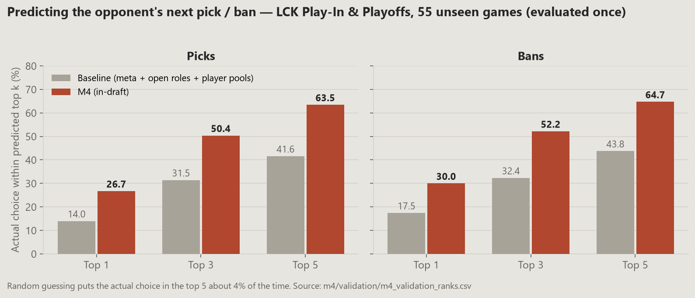
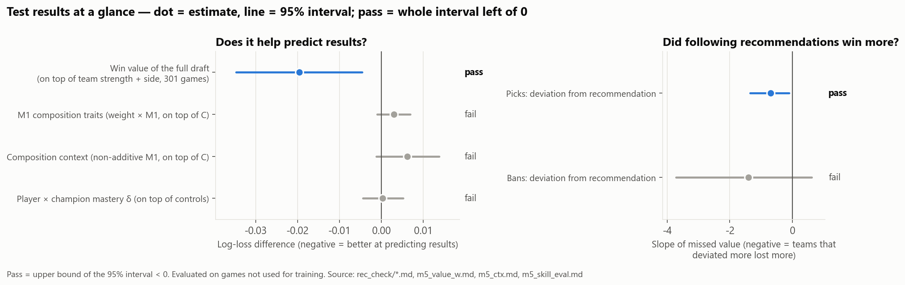
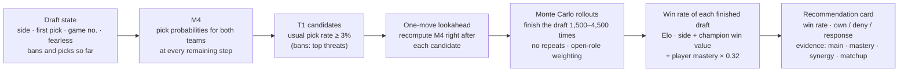
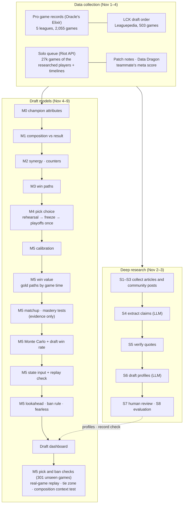
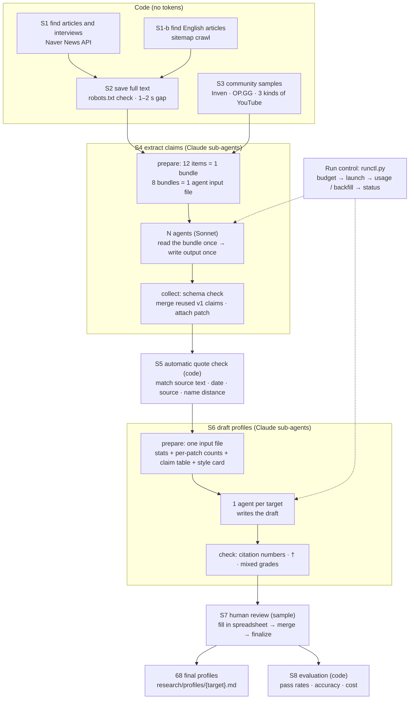
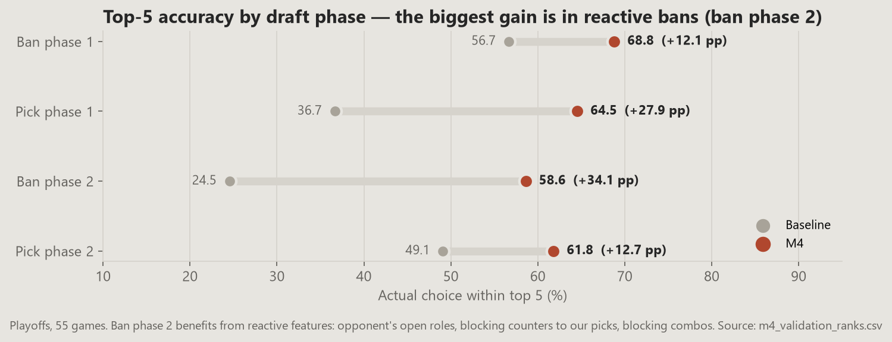
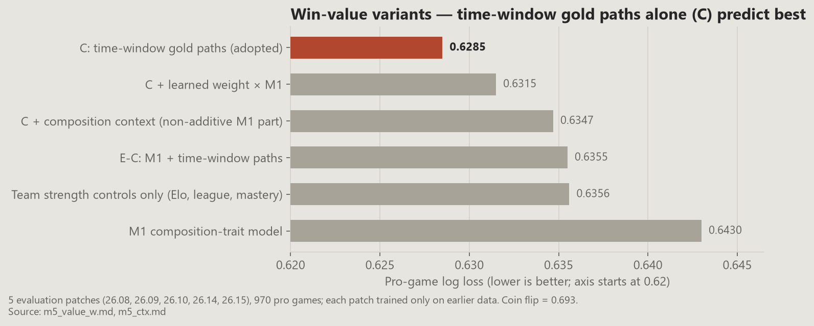
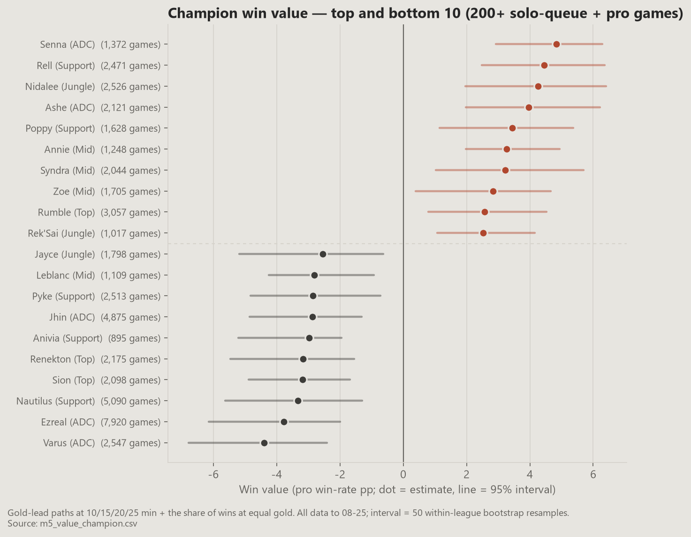
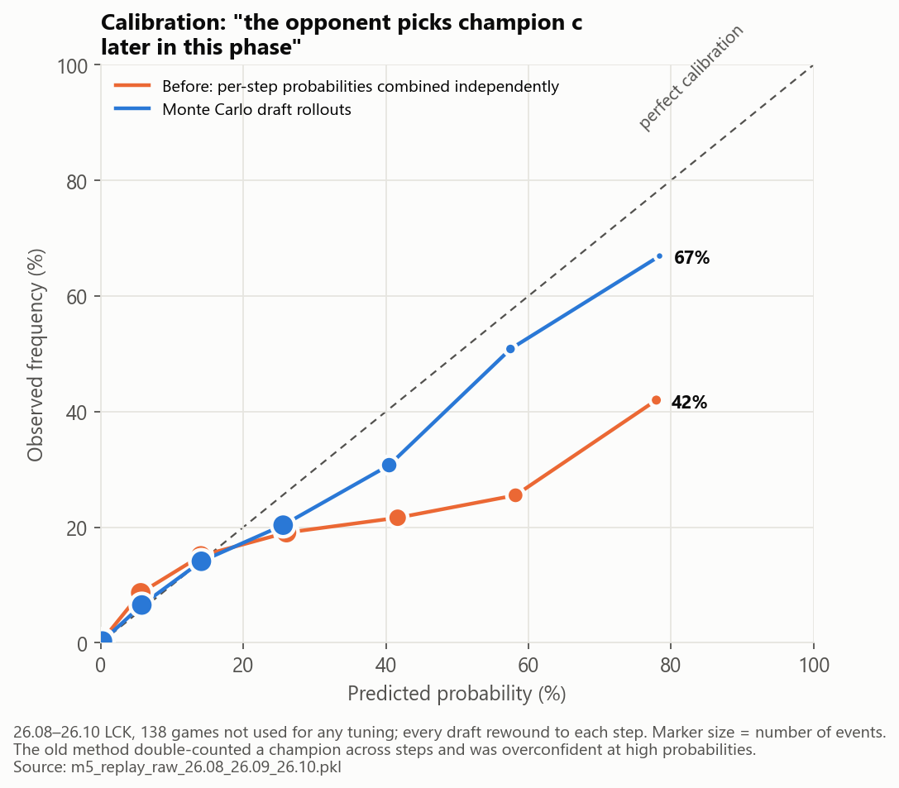
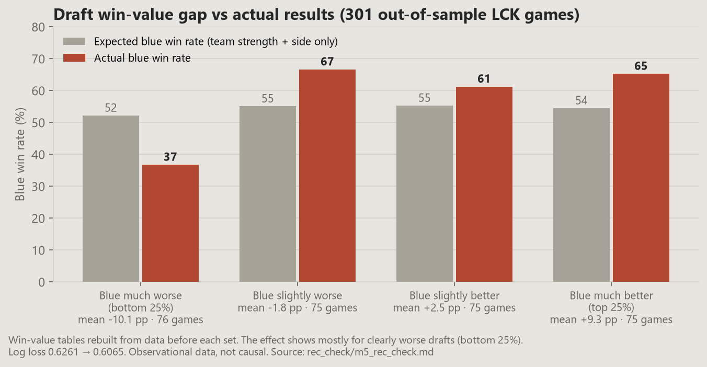

# LCK 2026 T1 Draft Analysis System

[한국어](README.md) | **English**

A draft tool built from the point of view of a T1 analyst. It **predicts what the opponent will pick or ban next, and recommends what T1 should pick or ban on its own turns.**
Everything was built on 2026 LCK regular-season data (up to Aug 25). The playoffs (from Aug 26) were held back and used once, at the end, as a final check.

---

## Demo

https://github.com/user-attachments/assets/038c93a7-49ab-4e1a-b793-719dc9e077c9

---

## Summary

### The questions
During a draft, an analyst wants to know three things.

| Question | Answer in this project |
|---|---|
| What will the opponent pick or ban next? | **M4 pick-choice model**: a probability for every legal champion, given the draft so far |
| If we take this champion, how much does our win chance change? | **Win value**: what a champion adds to gold at 10/15/20/25 min and to late-game wins (M0–M3 → M5) |
| So what should we pick or ban right now? | **M5 recommender**: for each candidate, play out the rest of the draft thousands of times and compare the expected win rate of the finished compositions |

On top of that, I built **profiles for 58 players and 10 teams** that summarise how articles, interviews and fan communities see each of them, with a source and a quote behind every claim (the "deep research" part).

### Approach in short
- **Models I can explain.** A recommendation has to come with a reason I can point to, so the value side uses GLMs (logistic, ridge, elastic net, Poisson) with coefficients and intervals. LightGBM is only mixed into opponent prediction (M4), where hit rate is the whole point.
- **Learn from the big data, let LCK differ.** The LCK has only 447 games, so the models are layered: 27k solo-queue games → 2,055 games from five pro leagues → LCK. Each lower layer is pulled harder toward zero.
- **Separate skill from champion.** Strong teams make their champions look good. Elo, player mastery and the number of pros in a solo-queue game are controlled for.
- **Use outcomes with more signal than win/loss.** A single 0/1 result is noisy, so the models also use 15-min lane gold, gold paths at 10–25 min, and fight outcomes.
- **Validate in time order only.** Settings were chosen on the last patches before the playoffs (26.14, 26.15). The playoffs stayed closed until the end. A final re-check used patches never touched during tuning (26.08–26.10).
- **An LLM in two research steps only.** Claude sub-agents extract claims and draft profiles. Search, storage, quote checking and evaluation are plain code.

### Results
| Item | Result |
|---|---|
| **Opponent prediction (M4, 55 playoff games, evaluated once)** | Actual choice in the top 5: **picks 63.5%, bans 64.7%** (baseline 41.6% / 43.8%, random about 4%) |
| Calibration of opponent probabilities (138 games not used for tuning) | Cases called "70% or more to pick c later in this phase" happened 67% of the time (old method: 42%) |
| Win value (5 evaluation patches, 970 pro games) | Log loss 0.6285 (team strength only 0.6356, M1 composition-trait model 0.6430) |
| Recommendation check (301 LCK games, models rebuilt before each patch) | Draft value predicts results (log loss 0.6261 → 0.6065). Teams that strayed further from the pick recommendations lost more (slope −0.70 [−1.35, −0.11]). Observational, so not causal |
| Ban check (same 301 games, 3,020 ban turns) | **Did not pass.** Weak evidence that straying from the ban ranking cost games (−1.40 [−3.71, +0.61]). The chance that the opponent takes an unbanned threat is right (actual 23.0%, predicted 22.9%) |
| Deep research | 68 final profiles, 10,497 claims, 94.0% of quotes verified against the source, human sample of 256: claims 98.4% supported, 94.9% attributed to the right person |
| Deliverables | Live draft dashboard (`dashboard/draft_server.py`), player and team scouting report (`dashboard/report.html`) |



**Three things I learned**
1. **Pro picks are explained by meta, comfort and reactions to the opponent far more than by "the winning pick".** Adding win value to M4 barely moved its accuracy. That is why "probability of picking" (prediction) and "win value" (recommendation) are kept apart.
2. **Champion-pair synergy and counters don't show up in win/loss. They only show up in 15-min gold.** The non-additive part of the composition model (M1) didn't improve pro-game predictions either. So pair effects are shown as evidence on the recommendation cards, not added to the win rate.
3. **Earlier games in the same series matter a lot.** 39.5% of bans from game 2 onward repeat a ban the same team made earlier in the series.

**Test results at a glance**: what helped on games the models never saw, and what didn't.



### How a recommendation is made

1. Given the bans and picks so far, M4 gives both teams' pick probabilities for every remaining step (opponent = prediction, T1 = usual habits).
2. For each T1 candidate, M4 is recomputed from the state right after that choice, so the opponent's likely reaction is included.
3. Those probabilities are used to play the rest of the draft to the end thousands of times. Champions already taken are removed, and probabilities drop as roles fill up.
4. Each finished 10-champion draft gets a win rate, and the results are averaged. Win rate = team strength gap (Elo) and side + summed champion win values + player-by-champion mastery.
5. For picks, candidates within the win-value uncertainty of the top one form a tie zone, ordered by how often T1 usually picks them. This spreads the recommendations a bit.
6. Bans are scored only by how much they lower the opponent's composition value. Close ones are tied and ordered by threat (chance the opponent picks it × value to them). The ban ranking failed out-of-sample validation and is shown as a reference only.
7. When T1 picks twice in a row (steps 8–9, 10–11, 18–19), pairs of champions are rolled out and recommended as well.

### Timeline


---

## Contents
1. [Validation rules and periods](#1-validation-rules-and-periods)
2. [Data: what I used and what I couldn't](#2-data-what-i-used-and-what-i-couldnt)
3. [Deep research: player and team profiles](#3-deep-research-player-and-team-profiles)
4. [Draft models step by step (M0–M5)](#4-draft-models-step-by-step-m0m5)
5. [Draft dashboard](#5-draft-dashboard)
6. [Limitations](#6-limitations)
7. [Running it, folders, data policy](#7-running-it-folders-data-policy)
8. [Sources and license](#8-sources-and-license)

The detailed design notes and decision log in `docs/` are in Korean.

---

## 1. Validation rules and periods

| Split | Period | Used for |
|---|---|---|
| Training | Start of the 2026 season to **Aug 25, 2026** (last regular-season game Aug 23, plus two days) | All model training and profiles |
| Tuning ("rehearsal") | LCK patches 26.14, 26.15 and Road to MSI | Choosing **settings** only (regularisation strength, feature groups). Coefficients are always refit on data before that point |
| Extra evaluation | 26.08, 26.09, 26.10 | Re-checking M5 win value and the replay test on games never used for tuning |
| Final test | **55 Play-In and playoff games from Aug 26** | M4 frozen first, then evaluated **once**. Nothing was changed after seeing the result |

- **Splits are by date.** Patch names (26.01–26.16) are only labels for time windows. Training and evaluation are always split in time order; a random split would let future games predict the past.
- **The rehearsal only uses what was known at the time.** Champion attributes, M1 predictions and M4 were rebuilt for each rehearsal patch from data before that patch.
- **Picking among many variants on the same rehearsal is optimistic.** That is why M4 was checked again on the playoffs, and M5 on patches the rehearsal never used.

---

## 2. Data: what I used and what I couldn't

### 2-1. Data for the draft models

| Data | Source | Size | Used in | Why |
|---|---|---|---|---|
| Pro game records | Oracle's Elixir CSV | LCK, LCK CL, LPL, LEC, LCS: **2,055 games** (LCK 447), to Aug 25 | M1–M3, M5 win value | Public data with in-game stats such as 15-min gold and objectives. LCK alone is too small, so four more leagues were added |
| LCK draft order | Leaguepedia Cargo API | 503 games × 20 steps (10,060 picks and bans) | M4 | Oracle's Elixir has no pick/ban **order**. Also the source for the 2026 First Selection rule (side and first pick chosen separately) |
| Solo queue | Riot Games API (match-v5 + timeline) | 105 accounts of the 58 researched players, **27,177 games** + frames at 10/15/20/25 min + every kill event | M0 attributes, M1–M3, M5 mastery | Measuring champion traits and matchups takes far more games than pro play has. These are the pros' own games, so close to the pro meta |
| Patch changes | Official Riot patch notes (KR) | 26.01–26.21, 834 champion changes | M0 rework detection, M4 buffs/nerfs | Whether a champion's profile changed in a patch |
| Champion info | Data Dragon (+ Meraki role classes) | 173 champions | M0 checks, name mapping | Official ids and names. Meraki roles act as an outside check on the attribute table |
| Rosters and schedule | Leaguepedia | 6 events, 10 teams, 67 players, 188 matches | Lineups, series info | Who played in each game |
| Teammate's meta score | Teammate's output | 111 match days × 172 champions | M4 meta feature | Pick-rate forecast built only from information up to the day before |

Join keys (game id, champion id, patch label 16.xx ↔ 26.xx) and how each source was collected are in [`docs/PIPELINE.md`](docs/PIPELINE.md), chapters 1–6 (Korean).

### 2-2. Data for the research
Six kinds of sources: news articles (Naver News API), interviews, English esports sites (via sitemaps), Inven, OP.GG Talk, and YouTube comments (LCK, team and analysis channels). Sizes are in [section 3](#3-deep-research-player-and-team-profiles).

### 2-3. What I couldn't use, and why

| Data | Reason | Instead |
|---|---|---|
| FM Korea | robots.txt disallows crawling | Left out |
| DC Inside | Heavy sarcasm, low reliability | Left out |
| Reddit | Decided to leave out (Nov 3) | Left out |
| Naver blogs | Considered, then dropped after review (Nov 3) | Added the OP.GG Talk esports board |
| Naver Sports article pages (`m.sports.naver.com`) | Disallowed by robots.txt (139 articles) | Used only the title and snippet from search results |
| Dot Esports | HTTP 451 (blocked from Korea) | Left out |
| Sheep Esports, esports.gg sitemaps | 403, so the whole domain was stopped per the rules and never requested again | The other four English sites |
| Bing search RSS | Only 10 results per query | Replaced by sitemap crawling |
| LoL Esports live stats feed (pro kill and position events) | Private API, 403 without auth. Riot's terms forbid accessing non-public areas and bots; the official route is a paid GRID licence | Oracle's Elixir summary stats (15-min gold etc.) + solo-queue timelines |
| OP.GG / U.GG / Lolalytics champion stats | No public API; scraping mostly violates their terms | Reference only |
| Leaguepedia player photo files | 403 when fetched by code, so the domain was stopped | The dashboard lets the browser load them by URL |
| High-elo KR solo queue in general (e.g. 300 Challengers) | About 40 hours on a dev key. Pair tables would get denser, but the gain in predicting results looked small | Only the researched players' own games |
| International and cup events (KeSPA Cup, EWC, MSI, FST: 188 games) | Tried in M4; strong-team accuracy didn't move (58.4 → 58.0%) | Kept the five leagues |
| 2025 season | 2026 draft rules (First Selection, fearless) differ, so mixing would distort it | Deleted |
| Caster and draft-review transcripts | Out of scope | Left out |
| Free LLMs | Decided not to use them | Claude Code sub-agents (Sonnet) |

Collection rules: follow robots.txt (with my own RFC 9309 parser), wait 1–2 s between requests, stop a site at the first 403/429/captcha, and no proxies, fingerprint spoofing or other workarounds. Blocks are logged in `research/raw/blocked.csv`.

### 2-4. Known gaps
- The solo-queue match-list API cuts off older games for some accounts (28 of 89; Faker has nothing before Apr 27). Early-season mastery may be underestimated.
- 2 of the 67 players who played (FenRir, Painter) have no solo-queue account found.
- One LCK game (Aug 1, Gen.G vs DK game 1) is missing from Oracle's Elixir, so only its draft is available.

---

## 3. Deep research: player and team profiles

**Goal:** summarise how people see each player and team, **with evidence**. Instead of scoring text with sentiment or aspect dictionaries, the sources are read directly into a table of "claim + exact quote + date + source", and the profiles are written from that table.

The full process (inputs and outputs of each step, how the agents were run, logs and numbers) is in [`docs/RESEARCH_PIPELINE.md`](docs/RESEARCH_PIPELINE.md) and the rules are in [`CLAUDE.md`](CLAUDE.md), both in Korean. This is the short version.



The LLM is used in S4 and S6 only. Each agent reads one input file, writes one output file and stops; its output is then checked by code (S4 schema, S5 quote match, S6 checks) and by a human sample (S7).

| Step | What | Who | Why this way |
|---|---|---|---|
| S1, S1-b | Find articles and interviews (Naver News API), English sites (sitemaps) | Code | LLM search isn't reproducible and costs tokens |
| S2 | Save full text (check robots.txt, stop on block signals) | Code | Enforce the collection rules in code |
| S3 | Community samples: up to 418 per target, **same share per patch** | Code | Topping up thin patches from other patches would distort form over time |
| S4 | Extract claims: only about the target, quotes copied verbatim | Claude sub-agents (192 input files) | Aspects are free text, not forced into a dictionary. Each agent reads and writes once to save tokens |
| S5 | Check quotes: match against source (similarity 0.9), date, source exists | Code | Catches quotes the LLM made up |
| S6 | Draft profiles: group aspects, separate source grades, compare with game stats | Claude sub-agents (one per target) | |
| S7 | Human review (two samples, 256 claims) | Me | Code can't tell whether a quote actually supports the claim |
| S8 | Evaluation | Code | |

**Results**

| Item | Value | Target |
|---|---|---|
| Targets | 58 players (starters with 10+ LCK games in the period) + 10 teams | |
| Article candidates / full texts saved / community samples | 2,092 (484 English) / 2,156 / 13,931 | |
| Claims extracted | 10,497 | |
| Quotes verified against the source | **94.0%** | ≥ 70% |
| Claims supported by their quote (human sample of 256) | **98.4%** | ≥ 80% |
| Claims about the right person (same sample) | **94.9%** | ≥ 85% |
| Tokens | about 29.7M (cap 33M) | |

- Sources are split into **eight grades** (fact, the player themself, journalists and experts, analysis-channel viewers, general viewers, fans, Inven, OP.GG) and shown separately. Conclusions are only ever stated as "these sources see the player this way".
- Most attribution errors came from community comments (blaming another player, a different team's story attached).

**Claims vs game records** (`src/research/record_check.py`, Nov 8). Do the sources point the same way as the stats?

| Comparison | Result |
|---|---|
| Player **overall** rating ↔ the player's usual lane-gold level (controlling for champion, opponent, team strength) | Rank correlation **+0.34** (p 0.01, 57 players): same direction |
| Player **laning** rating ↔ lane gold | +0.04: basically unrelated |
| **Per-champion** rating ↔ that player's mastery on the champion | +0.07 to 0.13, direction agrees 57–69% of the time (chance is 50%): weak |
| Team **early-game** rating ↔ actual early-game performance (M3) | +0.55 (9 teams, p 0.12) |
| Team overall rating ↔ win rate | +0.07: strong teams get criticised too (ratings seem to be relative to expectations) |

The sources roughly agree with the stats on who is good overall, but detailed judgements like laning or specific champions barely match the records. Adding research mentions to M4 didn't improve it (±0.4 pp), so on the recommendation screen the profiles are supporting material only.

---

## 4. Draft models step by step (M0–M5)

| Model | Question | Outcome | Method | Status |
|---|---|---|---|---|
| **M0** champion attributes | Once wins and game length are removed, what kind of champion is this? | 28 stats | Poisson / fractional logit / linear adjustment → 12 axes | Done |
| **M1** composition vs result | Which composition traits win? | Blue win | Hierarchical elastic-net logistic | Done |
| **M2** synergy and counters | Pair effects the attributes don't explain | Blue win / 15-min lane gold / fights | Ridge (logistic and linear) | Done |
| **M3** win paths | Composition → early gold → result | 15-min gold, objectives, win | Ridge / logit | Done |
| **M4** pick choice | What does this team pick in this situation? | Actual choice | Picks: LightGBM ranker. Bans: conditional logit + LightGBM | Frozen, tested on playoffs |
| **M5** recommendation | What should we ban or pick next? | Expected win rate of the finished draft | Calibration + time-window win value + Monte Carlo | Dashboard |

**Shared design**
- **Hierarchy:** solo-queue coefficient → shared pro deviation → per-league deviation. Deviation terms are regularised harder and pulled toward zero, so LCK starts from what the bigger data learned and only learns the difference.
- **Skill controls:** pro games use the pre-game in-league Elo gap (K=24, games in order up to Aug 25); solo queue uses the difference in number of researched pros per team; pro games also use each player's previous games on the champion (mastery).
- **No leakage:** solo-queue attributes for a game come from 5-fold cross-fitting that excludes that game. During the rehearsal, attribute tables were built only from solo queue before that patch (as-of).
- **Two separate outputs:** "probability of picking" (M4) feeds opponent prediction and bans; "win value" (M5) feeds our own recommendations.

### M0: Champion attribute table (`m0_attributes.py`)
- **Question:** is this champion frontline, engage, a late-game carry? Decided from actual game stats, not tags like "tank" or "AP".
- **Problem:** solo-queue stats are contaminated by wins and game length. Winners get more kills; long games pile up damage and healing. Used raw, "champions that win a lot" look like "champions with high kill pressure".
- **Method**
  - For each role × 28 stats, a game-level regression `stat ~ champion + patch + win + game-length decile`.
  - Per-minute stats use Poisson (game-time offset), shares and 0/1 stats use fractional logit, continuous stats use linear regression. The link function follows the outcome's distribution.
  - Values are moved to win = 0.5 and average length, shrunk by game count, then turned into within-patch percentiles.
  - The stats are grouped into **12 axes**: frontline, engage, protection, kill pressure, damage share, poke, split push, late carry, mid-game snowball, burst, ultimate damage, laning. Factor analysis (varimax) checked that the stats actually group this way. Range and damage type were added, plus **173 hand-checked ultimate-type labels**.
- **Handled**
  - Reworks: a patch-note candidate splits the table when the before/after gap exceeds the 95th percentile of other champions split on the same date → Shyvana 26.09, Bel'Veth 26.15.
  - 53 games with an AFK player (wasAfk + frozen timeline gold) dropped; off-role picks flagged.
- **Checks:** split-half agreement, AUC against an outside role classification (Meraki), agreement with pro stats.

  | Reliability | Axes | Evidence |
  |---|---|---|
  | High | Frontline, engage, protection, kill pressure | Split-half 0.97–1.00, role AUC 0.89–0.99 |
  | Low | Catch, tooltip-based teamfight ultimates | Role AUC 0.69 → teamfight ultimates use the human labels (AoE CC label AUC 0.91) |

- **Result:** rank correlation between adjusted and raw axes is 0.97–1.00, so the solo-queue table is not heavily contaminated by wins.

### M1: Composition vs result (`m1_comp.py`)
- **Question:** which composition traits (protection, engage, damage imbalance …) win games?
- **Method**
  - One row per game; features = 19 Blue − Red trait differences (team average of the 5 axes + range, melee count, damage imbalance, ultimate-type counts). Side is the intercept.
  - The second version adds 196 interaction terms: 91 cross-team terms `b_x·r_y − r_x·b_y` (swapping sides only flips the sign) and 105 within-team terms.
  - **Hierarchical elastic-net logistic:** shared + pro deviation × c_pro + league deviation × c_league. Elastic net keeps correlated trait variables together while zeroing the useless ones.
  - Controls: solo queue = difference in pros per side; pro = Elo gap + mastery.
  - Settings (26.14 and 26.15, grid of 256): C 0.03, l1 0.2, c_pro 0.3, c_league 0.5, c_int 1.0. Intervals from 100 bootstrap resamples.
- **Results** (pro log loss, lower is better, 0.693 = coin flip)

  | Evaluation games | Side only | Elo only | M1 v1 | **M1 v2** |
  |---|---|---|---|---|
  | 26.14 (136 games) | 0.703 | 0.667 | 0.651 | **0.650** |
  | 26.15 (225 games) | 0.682 | 0.644 | 0.646 | **0.642** |

  - Composition adds a **small** amount on top of team strength (1 SD of a trait ≈ 1–1.5 pp of win rate).
  - Winning side: protection, engage, kill pressure, AoE CC ultimates. Losing side: damage imbalance, reliance on ultimate damage, AoE ultimates without CC, burst.
  - Controlling for mastery changed the composition coefficients by at most 0.002, so little of the effect is "they won because they picked comfort champions".
  - These two patches were used to choose the settings, so they are not an untouched test.
- **What I found later:** widening evaluation to five patches showed M1 was worse than the controls alone early and mid-season (26.08, 26.09). With little training data the composition coefficients are unstable. So M1 was dropped from the final win value ([M5 step 2](#m5-step-2-win-value-m5_valuepy-m5_value_wpy)).

### M2: Synergy and counters (`m2_synergy.py`, `m2_combos.py`)
- **Question:** are there champion-pair effects (lane matchups, bot duos …) the attributes don't explain?
- **v1 (all pairs, win/loss):** with 18k pair terms fit on win/loss, it only beat M1 under very heavy regularisation, and then pair effects shrank to ±0.2 pp or less. The data isn't big enough to pin down each pair.
- **v2 (structured pairs + 15-min gold)**
  - Only structured pairs were kept. Synergy = ADC + support, jungle + mid, jungle + top. Counters = same-lane opponents + the 2v2 bot lane.
  - Lane matchups were measured on **15-min lane gold difference** (100k lane × game rows, ridge). It carries more information per game than win/loss and reflects the lane directly.
- **v3:** jungle + mid/top duo gold, and 250k solo-queue fights (15 s and 2,500-unit clusters, controlling for gold at the time of the fight) for same-team synergy.
- **Results**

  | Result | Value |
  |---|---|
  | Pair terms' added R² for 15-min lane gold (pro) | 0.066 → **0.074** |
  | Strong lane matchups | ±150–250 gold at 15 min (e.g. Gnar vs K'Sante +207) |
  | Jungle duo | Lee Sin + Orianna +142 gold (670 games) |
  | Same-team synergy in fight outcomes | Not visible |
  | Win prediction | Adding pair gold made pro evaluation games worse |

  → **Pair effects show up only in 15-min gold.** They are shown as evidence, not added to win rates.
- **Finding real combos:** how often pros draft two champions together (co-pick lift, double picks, ban reactions) identifies pairs pros treat as a combo (Ashe + Seraphine 7.8×, Xayah + Rakan 9.3×). The signal carries into the next patch (1.96×). Combined with duo gold and community mentions, that gives 22 meaningful-synergy pairs and 16 pairs pros often draft together.

### M3: Win paths (`m3_paths.py`)
- **Question:** does a composition win by getting ahead early (early type), or win at equal gold later (late type)?
- **Method:** ① "team gold → win" logistic by source and time ② composition → 15-min gold (ridge) ③ composition → first objectives ④ win ~ 15-min gold + composition → split each trait into an indirect (through gold) and a direct (at equal gold) effect.
- **Results**
  - Win log-odds per 1,000 gold: pro at 10/15/20/25 min = 0.69 / 0.53 / 0.45 / 0.42. +2,000 gold at 15 min in a pro game ≈ 76% win rate.
  - Early type = mid-game snowball, kill pressure, engage. Late type = late carry, AoE CC ultimates, frontline. Both = protection.
  - Team styles: T1 and Hanjin Brion mostly draft early compositions; Gen.G, DK and BNK draft late ones.
  - Execution: Gen.G earns +818 more 15-min gold than its compositions predict, and wins +15.8 pp more than its gold predicts.
- M3's idea of time-window paths became the basis of M5's win value.

### M4: Pick choice (`m4_*.py`, frozen in `m4/final/`)
- **Question:** what will this team pick or ban in the current situation?
- **Method:** at every draft step, learn "which of the ~120–134 available champions was actually chosen". It started as a conditional logit (softmax within a step), then features were added one at a time and compared on the rehearsal.
- **Features:** meta (teammate's meta score; same-patch pick rate across the five leagues, which works as an early signal because new patches start 4–7 days earlier in LEC and LCS), pick-order fit, player pool, recency and mastery, open roles, fearless, reactions to the opponent's picks (counters, blocking combos, substitutes), ban habits of first- and second-pick teams (C2), and **bans, picks and results from earlier games in the same series**.
- **Rehearsal progress** (LCK 26.14 + 26.15 + RTM, actual choice in the top 5)

  | Step | Picks | Bans | Change |
  |---|---|---|---|
  | Baseline (meta + open roles + player pool) | 45.6% | 50.1% | |
  | v0 conditional logit | 57.6% | 54.9% | Order, player pool, meta |
  | v1 | 61.9% | 64.3% | Mostly the **reaction features** (ban phase 2: 33.0 → 57.4%) |
  | + C2 first/second-pick ban habits | 62.6% | 66.5% | |
  | + P1 same-patch five-league meta | 62.6% | 67.7% | Bans only |
  | Pick LightGBM (5 leagues, LCK weight 3) | 67.2% | | Non-linearity +3.6 pp, five-league data +1.0 pp |
  | **Final** (+ series features, ban ensemble) | **66.5%** | **69.8%** | |

- **Tried and dropped** (within ±0.5 pp on the rehearsal, i.e. noise): win value (M1, M2), per-team coefficients, blind-pick safety, champion embeddings, team-style match, research mentions, international and cup data, series-level fearless planning, two-stage role prediction.
- **Why LightGBM here:** M4's job is to be right, not to explain. For picks LightGBM clearly beat the conditional logit (62.6 → 67.2%); for bans the linear model was better, so bans use a z-score ensemble of both. The recommendation side (win value) stays GLM.
- **Final test** (14 Play-In + 41 playoff = 55 games, once)

  | Actual choice in the top 5 | Picks | Bans |
  |---|---|---|
  | **M4 (in-draft, with earlier games in the series)** | **63.5%** | **64.7%** |
  | M4 (only information up to the day before) | 63.5% | 62.4% |
  | Baseline | 41.6% | 43.8% |

  - 3–5 pp lower than the rehearsal, but the gap over the baseline (+21–22 pp) got bigger.
  - Strong teams have wide champion pools and are harder (Gen.G 54.5%, Hanwha 57.6%). T1: picks 62.2%, bans 63.3%.

  

### M5: Live recommendations

M5 combines M4 (probability of picking) with win value to answer "what should we do now". It was built in the steps below.

#### M5 step 1: Calibration (`m5_calibrate.py`)
- **Problem:** M4 had only been checked on rankings (top k). Recommendations need **probabilities**.
- **Method:** for each rehearsal patch, refit the final settings on data before it to get **out-of-sample scores**, then fit the temperature τ in `p = softmax(s / τ)` by log loss.
- **Result:** τ by phase: ban 1 0.84, pick 1 0.84, ban 2 0.93, pick 2 0.98. A τ fit on in-sample scores (0.59–0.72) was 0.07–0.12 worse in log loss, which confirmed the old probabilities were overconfident.

#### M5 step 2: Win value (`m5_value.py`, `m5_value_w.py`)
- **Problem:** the old win value (M1 traits + M2 single-champion terms) was fit only on win/loss (0/1), so it was noisy and couldn't tell early from late.
- **Method (split by game time)**
  1. For each source and time (10/15/20/25 min), convert "team gold lead → win log-odds" into a state L_t. **Games that ended before that time are set to ±3.5** (42% of solo-queue games end before 25 min, so they can't be dropped).
  2. At each time, ridge regression `L_t ~ champion@role (shared + pro deviation) + controls`.
  3. The part won at equal gold: logistic `win ~ offset L_25 + champion`.
  4. Champion value = 25-min path + equal-gold part. Shares by window (early to 10 min, 10–15, …, late) come out separately.
- **Why:** measuring an outcome at several times gives several times more information per game than one win/loss. Gold alone would penalise champions that win with less gold (Azir, Milio, Yuumi), so the equal-gold part is estimated on its own.
- **Variants compared** (pro log loss, 5 evaluation patches = 26.08, 26.09, 26.10, 26.14, 26.15, 970 pro games)

  | Variant | Log loss |
  |---|---|
  | Controls only (league, Elo, mastery) | 0.6356 |
  | M1 composition traits only | 0.6430 |
  | E-C = M1 + time-window paths (best when judged on two patches) | 0.6355 |
  | W-EC = controls + **w** × M1 + time-window paths (w fit on data) | 0.6301 |
  | **C = time-window paths (no M1, adopted)** | **0.6285** |

  - On 26.14 and 26.15 alone, E-C looked best. Over five patches, M1 was weak early in the season and the gain disappeared.
  - Letting the data set how much to trust M1 (w, fit on the last 15% of training) gave values near zero on all five patches (−0.43 to 0.22). **M1 adds nothing on top of the time-window paths**, so it was dropped. Choosing on two patches alone would have picked up luck.

  

- **Final table** (`m5_value_champion.csv`): fit on everything up to Aug 25, pro scale k = 1.23, intervals from 50 game resamples. Of 212 champions with 200+ games, 44 have intervals that exclude zero. Examples: Senna (ADC) +4.8 pp, Rell +4.4, Ashe +4.0 / Varus −4.4, Ezreal −3.8.

  

- **Checks:** R² by time: the champion share is largest at 10 min and shrinks later. Changing the value for finished games (K) from 2 to 5 gives the same result.

#### M5 step 3: Lane matchups from attributes (`m5_counter.py`), not adopted
- **Idea:** the M2 matchup table only has values for pairs with 15+ games (26% of same-role pairs). Attribute differences (12-axis antisymmetric interactions) could give every pair a value, with the pair term as the residual.
- **Result:** attribute interactions predicted next-patch lane gold worse than the M2 pair table (R² 0.0720 vs 0.0740). Adding matchups to win prediction made pro games worse (0.6552 → 0.6613). → **Matchups stay out of the win rate** and appear only as evidence.
- Side note: L-BFGS didn't converge with sparse + dense columns and heavy regularisation, so I switched to an exact normal-equation solve.

#### M5 step 4: Player × champion mastery (`m5_skill.py`)
- **Question:** how much better is Faker's Cassiopeia than an average Cassiopeia?
- **Method:** outcome = 15-min gold vs the lane opponent (19,310 pro rows + 28,996 solo-queue rows). After removing the champion average, the player's usual level, the opposing champion, the opposing player and team Elo, ridge estimates what's left for each player × champion (δ). Few games means it shrinks to 0.
- **Result:** a little better on 15-min gold (R² 0.1052 → 0.1099). No gain for win prediction on top of the controls (+0.0003 [−0.0044, +0.0052]). Still, the scale k fit per patch was positive in all 5 (mean 0.32).
- **How it's used:** only **δ × 0.32** is added to win value on the dashboard, and the table is shown as evidence (e.g. Faker Cassiopeia +444 gold).

#### M5 step 5: Monte Carlo + win rate per finished draft
- **Problem:** the old recommender added up "opponent picks Cassiopeia at step 7/10/11 with 30% / 30% / 20%" as if independent and got an inflated 57%. In reality a champion can only be picked once, and we might ban it in between.
- **Method:** for each candidate, play the rest of the draft to the end thousands of times. Both teams' probabilities come from M4, taken champions are removed, and each finished 10-champion draft scores `σ(base + (T1 value sum − opponent value sum) / 25)`, averaged. All candidates share the same random numbers to reduce noise in the differences.

#### M5 step 6: State input + replay check (`m5_state.py`, `m5_replay.py`)
- **State input:** from the bans and picks so far, build **the M4 rows for every remaining step at once**, by inserting the future steps as "ghost records" (scored but never added to the state). Features match the training table exactly (difference **0** over 240 steps); one state takes 0.22 s.
- **Replay check:** rewind real games to the state before each step and compare "probability the team picks c later in this phase" with what happened. The model was refit on data before each patch every time.
  - Checked on 94 rehearsal games, then the design change made there (open-role weighting) was checked again on **138 LCK games from 26.08–26.10 that the rehearsal never used**.

  | "Team X picks c later in this phase" (138 games) | Old independent sum | **Rollouts** |
  |---|---|---|
  | Log loss | 0.0588 | **0.0555** |
  | Sum of predictions ÷ actual count | 0.93 | **1.00** |
  | Actual rate when the prediction was 70%+ | 42% | **67%** |

  

  | Log loss of the actual choice at step s (from state t) | Next step | 7+ steps ahead |
  |---|---|---|
  | Current-state M4 probabilities as-is | 2.434 | 4.368 |
  | **Rollouts** | **2.434** | **3.972** |

  - Switching role handling from "role share ≥ 0.1 only" to "down-weight only as roles fill up" made next-step probabilities identical to M4. The effect points the same way, but its game-level interval just crosses zero ([−0.126, +0.019]).

#### M5 step 7: One-move lookahead, ban rule, fearless series
- **Lookahead:** for each candidate, recompute M4 from the state right after it and roll out from there, so the opponent's response is included (e.g. the value of banning Jarvan IV goes from 0.00 to +0.29 pp).
- **Ban rule:** a ban is scored only by how much it lowers the opponent's composition value. Filling T1's remaining picks from habit created an illusion that banning a low-value champion T1 habitually picks was a gain. Bans use 4,500 rollouts (standard error about 0.04 pp); differences within twice the error are tied and ordered by threat.
- **Fearless series:** finished games are added to the state table, so fearless exclusions and series features are computed exactly as in training.

#### M5 step 8: Team strength gap, double picks
- **Team strength:** base win log-odds = 0.093 × side (blue +1 / red −1) + 2.32 × (T1 Elo − opponent Elo) / 400, from a logistic fit of blue win on Elo gap over the five pro leagues. The win-value table was fit on top of the same Elo control, so they add on the log-odds scale.
  - Elo on Aug 25: Gen.G 1681, Hanwha 1653, DK 1614, T1 1599, KT 1521 → T1 on red side vs Gen.G starts at 36.1%.
- **Double picks:** the top 6 single recommendations are paired without role overlap and rolled out from the state after both picks (e.g. Lee Sin + Olaf 41.1% vs Lee Sin alone 40.6%).

#### M5 step 9: Would following the recommendations have won more? (`m5_rec_check.py`)
- **Problem:** the expected win rates so far used a win-value table fit on all data up to Aug 25, so they were in-sample. And real results can't show "what if they had followed it" directly.
- **Method:** for each of 8 LCK patches (26.07, 26.08, 26.09, 26.10, RTM, 26.14, 26.15, 26.16; 301 games), rebuild the win-value table and M4 **using only data before that patch**.
  - ① value of the finished drafts → actual result
  - ② missed value: at each of 3,020 pick turns (both teams), "expected win rate of the top recommendation − of the actual pick", summed Blue − Red per game and related to the result.
- **Results**

  | Check | Result |
  |---|---|
  | ① Log loss (Elo + side only → + draft value) | 0.6261 → **0.6065** (diff −0.0196 [−0.0347, −0.0046]). −0.0406 on the 70 games from 26.07 and 26.16, which were never used to choose win-value settings |
  | ① Slope | 1.48 [0.75, 2.29] → predicted win rates aren't inflated. The effect comes mostly from clearly bad drafts (bottom 25%: expected 52.2% → actual 36.8%) |
  | ② Missed-value slope | **−0.70 [−1.35, −0.11]**, p 0.04 → teams that strayed further from the recommendations lost more. The size is in line with the model's own scale (−1) |
  | Actual pick = top recommendation / in top 5 | 11.4% / 52.3% (vs 26.9% / 66.6% for the usual-pick-rate ranking) |

  

- **Reading it:** the recommendation's basis (win value) predicts results out of sample. It is still observational (only Elo and side controlled), the effect is small (p 0.04) and it varies by patch (no help on 26.09 or RTM).
- The same run produces the data for the dashboard's **real-game replay** tab (`replay.json`, [section 5](#5-draft-dashboard)).

#### M5 step 10: Spreading out recommendations with a tie zone (`m5_rec_diverse.py`)
- **Problem:** out of sample, the top recommendation covered only 70 champions, and the top 5 (Ashe 12.8%, Rumble, Syndra, Annie, Ahri) made up 39%. Real pro picks cover 112 champions with 15% in the top 5.
- **Rule** (fixed before running): a candidate is tied with the top one if the gap is ≤ √(σ_top² + σ_c²) (σ = win-value half-interval / 1.96). Inside the tie zone, order by T1's usual pick rate.
- **Result:** top-5 share 39.0 → 35.8%, match with actual picks 11.4 → 16.2%. Cost by the model's own measure: 0.30 pp; the missed-value slope stayed negative (−0.67). → **Adopted.**
- **Limit:** the tie zone averages 2.2 champions, so the effect is small. The remaining concentration comes from win value being a per-champion number that ignores the rest of the draft.

#### M5 step 11: Composition context test, the non-additive part of M1 (`m5_ctx.py`), not adopted
- **Idea:** fixing the concentration needs values that depend on the other champions in the draft.
  - Context = M1 prediction − its per-champion additive approximation: the part that depends on teammates (damage imbalance, ultimate counts, trait interactions).
  - That context was added on top of win value with a weight w.
- **Result** (5 evaluation patches, 970 pro games): 0.6285 → 0.6347, diff +0.0062 [−0.0012, +0.0138], i.e. leaning worse. w was −0.26 to −2.06 on pro games in the rehearsal and −0.09 in the final fit. Only solo queue leaned the right way (+0.27).
- **Reading it:** pros already draft balanced compositions, so the differences are small and mixed with selection bias. Lane matchups and duos gave the same answer. → Composition context is shown only as evidence chips.

#### M5 step 12: Ban check (`m5_ban_check.py`), did not pass
- **Method:** same out-of-sample setup as the pick check.
  - Candidates at each ban turn: opponent's top 12 threats + T1's top 3 usual bans + the actual ban.
  - Each candidate is banned and rolled out, then ranked by how much it lowers the opponent's composition value (same rule as the dashboard).
- **Results** (3,020 ban turns)
  - Missed-value slope −1.40 [−3.71, +0.61] → fails the bar (upper bound < 0). With picks in the same model: picks −0.66 [−1.34, −0.07], bans −1.22 [−3.59, +0.88].
  - The opponent took the unbanned top threat 23.0% of the time, against 22.9% predicted → the first part of the threat score (chance the opponent picks it) is right.
  - Ban recommendations are even more concentrated than picks: top-5 share 50.8% (Ashe 15.7%).
- **Action:** ban scores stay as they are, and the dashboard's ban panel says "did not pass validation".

---

## 5. Draft dashboard

```bash
python dashboard/draft_server.py --port 8770   # ~20 s to start → http://localhost:8770
```

- **Korean / English switch** in the top bar.
- **Top:** a broadcast-style draft board. Five bans and five picks per side (champion art + player name), the current slot highlighted, team logos and Elo, the phase and all 20 steps.
- **Bottom:** recommendation cards and a champion grid.
  - **Opponent turn:** M4's top 8 predictions. Auto-play takes the top one, or enter the real choice.
  - **T1 turn:** 3 recommendation cards + a table. Big number = expected win rate. Own comp (value to us), deny (chance the opponent picks it × value to them), response (change from the lookahead), the opponent's likely next move, and evidence chips (main, mastery, synergy, matchup, opponent's main).
  - Picking any champion recomputes from that state. On double-pick turns, pair recommendations appear too.
  - Undo; at the end of a game, choose the winner to start the next fearless game.
  - Tied pick candidates are marked. The ban panel notes that the ban ranking did not pass validation.
- **Real-game replay tab** (start screen): pick any of the 301 out-of-sample LCK games (64 T1 games) and step through it, with the actual choice next to that moment's top 5 recommendations.
  - Also shows the pre-game forecast (strength only → + actual drafts), each team's missed value and the real result.
  - Bans are not compared.
  - Data comes from `replay.json`, written by `m5_rec_check.py` (no source text).
- Speed: about 7 s for a ban, 4 s for a pick. It's a local tool for one person.
- The player and team scouting report is a separate static page (`python dashboard/build.py` → `dashboard/report.html`, see [`HANDOFF.md`](HANDOFF.md), Korean).

---

## 6. Limitations

- **It doesn't prove that following the recommendations wins more games.** On 301 out-of-sample games, teams that strayed further from the pick recommendations did lose more (slope −0.70, p 0.04), but this is observational and other factors besides Elo and side may be mixed in. The best-validated part is the probability of what the opponent will pick.
- **The ban ranking failed out-of-sample validation.** The opponent pick probabilities are right, but the evidence that ban value (lowering the opponent's composition value) translates into wins is weak.
- Win value is per champion, so composition interactions enter the rollouts only through role filling. The M1 composition model, its non-additive part, and lane matchups all failed to improve pro predictions and were left out.
- As a result, recommendations lean toward a few champions (Ashe, Rumble, Syndra). The tie-zone rule only reduced this slightly (top-5 share 39.0 → 35.8%, vs 15% in real pro picks).
- Champions picked inside a rollout don't feed back into M4's features (only the one-move lookahead does). T1's remaining turns are filled from its usual habits.
- High probabilities are still a little overconfident (cases called 50–70% happened 44–51% of the time).
- The research profiles describe how sources see a player, not the player's actual skill. Human review covered a sample of 256 claims, applied directly to 9 of the 68 targets.

---

## 7. Running it, folders, data policy

### Running
```bash
pip install -r requirements.txt
cp .env.example .env        # add API keys (Riot, Naver search, ...)
```

```bash
python src/pipeline/m0_attributes.py           # M0 champion attributes
python src/pipeline/m1_comp.py --boot 100      # M1 composition vs result (~30 min)
python src/pipeline/m2_synergy.py --boot 30    # M2 synergy and counters (~7 min)
python src/pipeline/m3_paths.py                # M3 win paths
python src/pipeline/m4_validate.py --parity    # M4 validation-mode code check (doesn't look at playoffs)
python src/pipeline/m5_calibrate.py            # M5 calibration
python src/pipeline/m5_value.py                # M5 win-value rehearsal (--reuse for tables only)
python src/pipeline/m5_value_w.py              # M1 weight fit → final win-value table
python src/pipeline/m5_state.py --parity       # state-input features = training table check
python src/pipeline/m5_replay.py --sets 26.08,26.09,26.10   # draft replay check (~20 min)
python src/pipeline/m5_sim.py --opp Gen.G --opp-first --sets 2   # simulated draft report
python src/pipeline/m5_rec_check.py            # recommendation check + replay data (~15 min)
python src/pipeline/m5_rec_diverse.py          # tie-zone rule comparison (seconds)
python src/pipeline/m5_ctx.py                  # composition context test (~1 min)
python src/pipeline/m5_ban_check.py            # ban check (~25 min)
python dashboard/draft_server.py --port 8770   # draft dashboard
python src/research/runctl.py status           # research progress
python src/research/record_check.py            # research claims vs game records
python src/pipeline/make_readme_figs.py        # the 7 README charts → docs/img/ (needs matplotlib, aggregates only)
```
- The final M4 test (`m4_validate.py --run --once`) has already been run once. If its result exists it won't run again.
- How to run each collection step is in [`docs/PIPELINE.md`](docs/PIPELINE.md), chapter 1 (Korean).

### Folders
```
src/pipeline/      draft data collection (a–i) + models m0–m4 + recommender m5_* (m5_draft = dashboard engine)
src/research/      player and team profile research (S1–S8), record_check.py
research/config/   research targets, search terms, sample sizes, prompts
dashboard/         draft dashboard (draft_server.py, draft.html), scouting report (build.py, template.html)
docs/              PIPELINE.md (data collection + model design and run log; ch. 7-7 covers M0–M5)
                   RESEARCH_PIPELINE.md (the full research process)
                   decisions.md (decisions and reasons, by date)
                   img/ (README charts)
CLAUDE.md          research rules and status (top-priority document)
HANDOFF.md         handoff notes (setup, rules, the two screens, what's left)
```

### More detail (Korean)
| Topic | Document |
|---|---|
| Every variant and number tried for each model | [`docs/PIPELINE.md`](docs/PIPELINE.md), ch. 7-7 |
| Research steps, inputs/outputs, agent runs | [`docs/RESEARCH_PIPELINE.md`](docs/RESEARCH_PIPELINE.md) |
| Why things were decided (by date) | [`docs/decisions.md`](docs/decisions.md) |
| Handoff (setup, rules, screens, what's left) | [`HANDOFF.md`](HANDOFF.md) |

### Data policy
- This repository has **code, design documents and settings only**. No data is redistributed.
- Collected text (article bodies, community posts, comments, quotes) and game data (`data/`, `research/` outputs) are for personal analysis and are not uploaded, so the models and dashboard can't be run from this repository alone.
- The dashboard font file isn't included because its redistribution terms weren't confirmed (a system font is used instead).
- API keys live only in `.env`.

---

## 8. Sources and license

### Data sources
| Data | Source | Notes |
|---|---|---|
| Pro game records (LCK, LCK CL, LPL, LEC, LCS) | [Oracle's Elixir](https://oracleselixir.com), Tim Sevenhuysen | 2026 match data CSV. Terms of the original source apply |
| Draft order, rosters, schedule, player careers | [Leaguepedia](https://lol.fandom.com) (Fandom) Cargo API | Wiki content license (CC BY-SA) and Fandom terms apply |
| Solo-queue games and timelines | [Riot Games API](https://developer.riotgames.com) (match-v5, league-v4, account-v1) | Collected with a development key; raw data not published |
| Champion info, names, art | Riot [Data Dragon](https://developer.riotgames.com/docs/lol#data-dragon), patch notes (leagueoflegends.com) | Champion art on the dashboard is loaded by the browser straight from Data Dragon |
| Champion role classes (to check the attribute table) | [Meraki Analytics](https://github.com/meraki-analytics) | Used only as an outside reference |
| Pro players' solo-queue accounts | [Trackingthepros](https://www.trackingthepros.com) | Account matching |
| Meta score (match day × champion) | Teammate's work | Used as an M4 meta feature |
| Opinion research | Naver News search API, English esports site sitemaps, Inven, OP.GG Talk, YouTube comments | robots.txt followed. Source text and quotes are not published, only aggregates |

### Riot Games notice
T1 Draft Analysis isn't endorsed by Riot Games and doesn't reflect the views or opinions of Riot Games or anyone officially involved in producing or managing Riot Games properties. Riot Games, and all associated properties are trademarks or registered trademarks of Riot Games, Inc. Team names, logos and player names belong to their owners.

### Code license
The code is under the [MIT License](LICENSE). The data above and anything derived from it (source text, game data, model outputs) are not covered and follow each source's terms.
