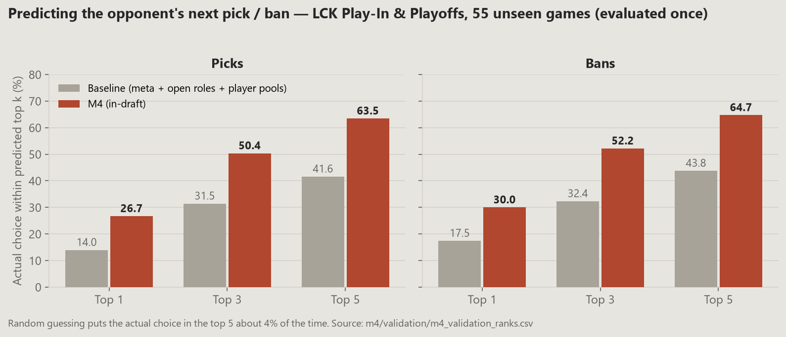
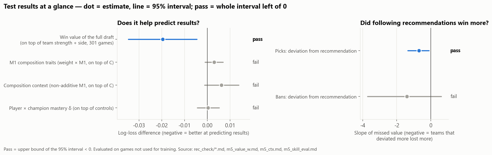
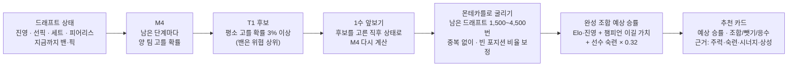
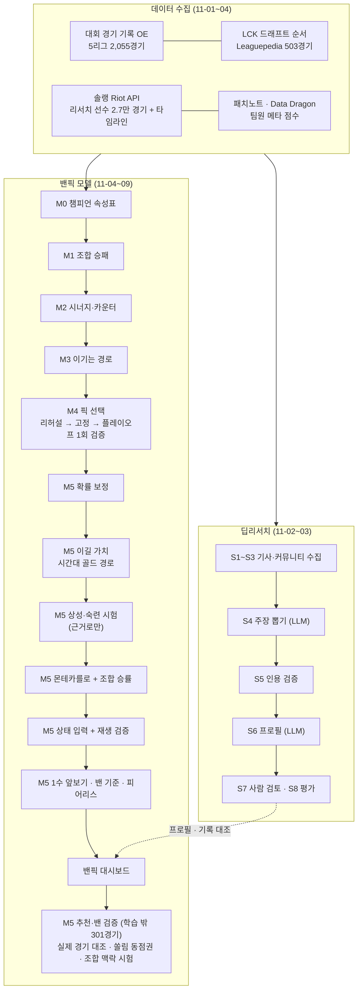
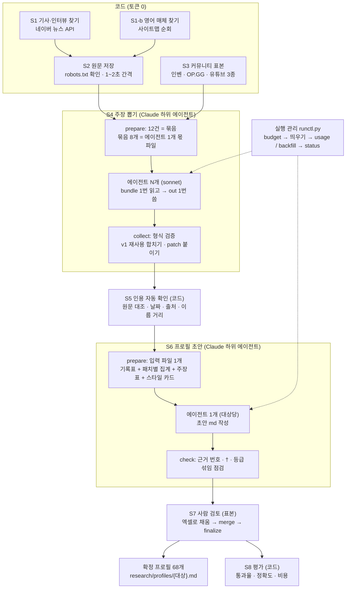
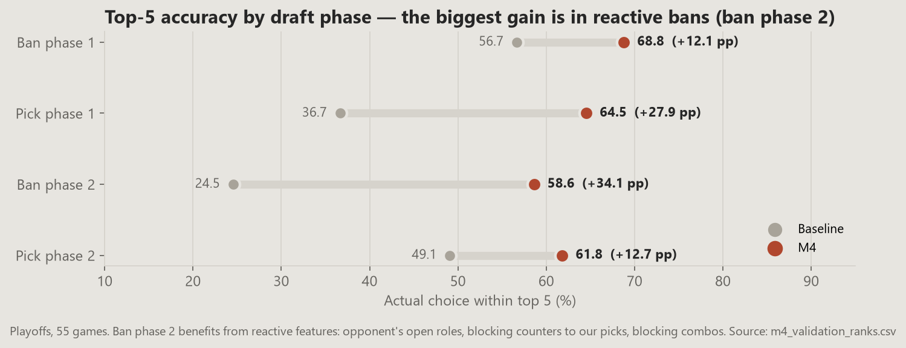
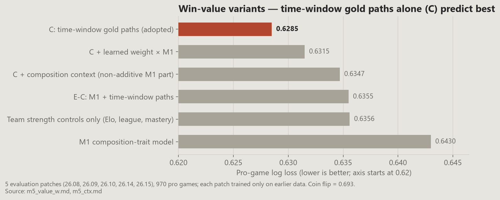
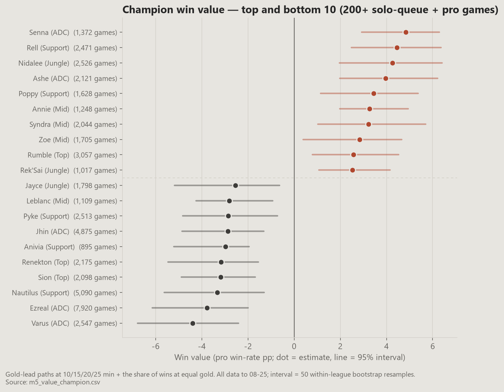
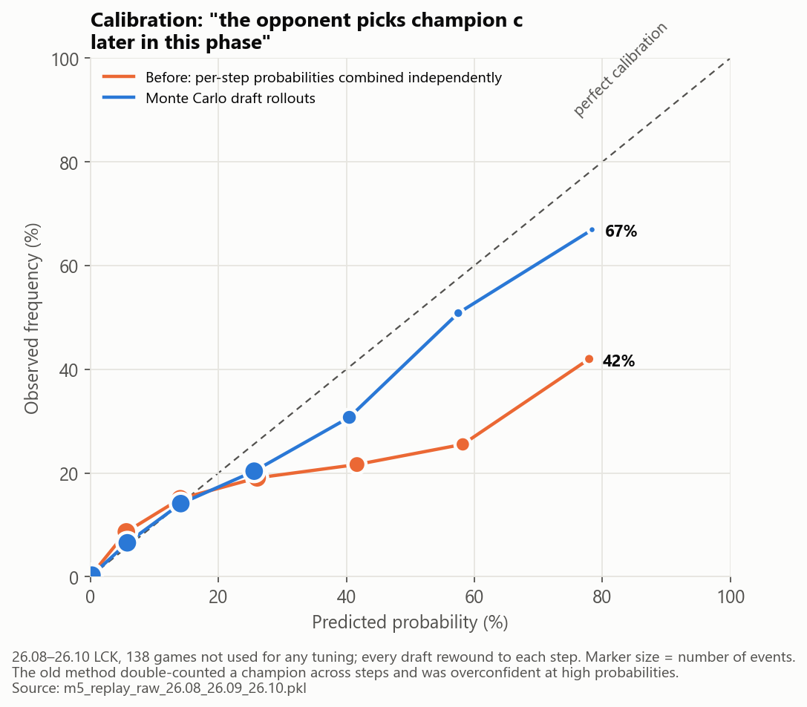
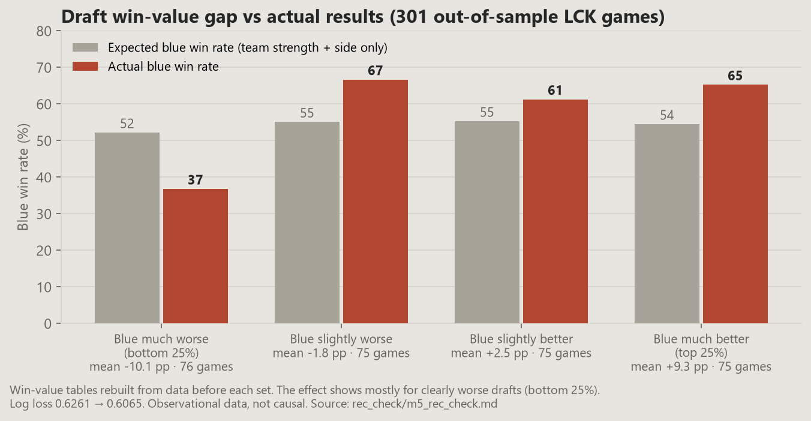

# LCK 2026 T1 밴픽 전력분석 시스템

T1 전력분석관 입장에서 **상대 팀이 무엇을 밴·픽할지 예측하고, T1이 다음 차례에 무엇을 밴·픽해야 하는지 추천**하는 시스템입니다.
2026 LCK 정규시즌(08-25까지) 자료로 만들었고, 플레이오프(08-26~)는 마지막에 한 번만 검증에 썼습니다.

---

## 추천 시스템 시연

https://github.com/user-attachments/assets/038c93a7-49ab-4e1a-b793-719dc9e077c9

---

## Summary

### 무엇을 분석하고 싶었나
드래프트 중에 분석관이 알고 싶은 것은 세 가지입니다.

| 질문 | 이 프로젝트의 답 |
|---|---|
| 상대가 다음에 무엇을 고르거나 밴할까? | **M4 픽 선택 모델** — 드래프트 상태를 보고 후보 챔피언마다 확률 |
| 우리가 이걸 고르면 승률이 얼마나 오르나? | **이길 가치** — 챔피언이 10·15·20·25분 골드와 후반 승부에 주는 몫 (M0~M3 → M5) |
| 그래서 지금 무엇을 밴·픽해야 하나? | **M5 추천** — 후보마다 남은 드래프트를 수천 번 굴려 완성 조합의 예상 승률 비교 |

여기에 "사람들이 이 선수·팀을 어떻게 보나"를 출처 근거와 함께 정리한 **선수 58명 · 팀 10개 프로필**(딥리서치)을 더했습니다.

### 방법론 한눈에
- **설명할 수 있는 모델을 기본으로**: 추천의 근거는 회귀 계수와 신뢰구간으로 댈 수 있어야 해서 GLM(로지스틱·릿지·엘라스틱넷·포아송)을 썼습니다. 적중이 목적인 상대 예측(M4)만 LightGBM을 섞었습니다.
- **많은 자료에서 배우고 LCK는 차이만**: LCK는 447경기뿐이라 솔랭 2.7만 경기 → 대회 5리그 2,055경기 → LCK 순으로 계층을 쌓았습니다. 아래 층일수록 0 쪽으로 강하게 당깁니다.
- **실력과 운을 떼어 내기**: 강팀이 고른 챔피언이 좋아 보이는 착시를 막으려고 Elo·숙련도·솔랭 프로 수를 통제했습니다.
- **승패 대신 정보가 많은 중간 결과**: 승패(0/1)는 잡음이 커서 15분 라인 골드, 10~25분 골드 경로, 교전 결과를 결과변수로 썼습니다.
- **시간 순서로만 검증**: 설정은 플레이오프 직전 패치(26.14·26.15)로 고르고, 플레이오프는 끝까지 열어 보지 않았습니다. 마지막에는 리허설에 안 쓴 패치(26.08~26.10)로 다시 확인했습니다.
- **LLM은 리서치의 두 단계에만**: 주장 뽑기와 프로필 초안만 Claude 하위 에이전트가 하고, 찾기·저장·인용 검증·평가는 코드가 했습니다.

### 최종 결과
| 항목 | 결과 |
|---|---|
| **상대 예측 (M4, 플레이오프 55경기 1회 검증)** | 상위 5 안 적중 **픽 63.5% · 밴 64.7%** (기준선 41.6% · 43.8%, 무작위 약 4%) |
| 상대 예측 확률의 보정 (리허설에 안 쓴 138경기) | "상대가 남은 픽에서 c를 고를 확률"을 70% 이상이라 한 것이 실제 67% (예전 방식은 42%) |
| 이길 가치 (평가 패치 5개, 대회 970경기) | 로그 손실 0.6285 (팀 실력 통제만 0.6356, 조합 성격 모델 M1 0.6430) |
| 추천 검증 (LCK 학습 밖 301경기, 세트 시작 전 자료로만) | 완성 조합 가치가 승패를 맞힘 (로그 손실 0.6261 → 0.6065). 픽 추천에서 더 벗어난 팀이 더 짐 (기울기 −0.70 [−1.35, −0.11]). 관찰 자료라 인과는 아님 |
| 밴 검증 (같은 301경기, 밴 차례 3,020번) | **기준 미달**: 밴 추천에서 벗어난 만큼 더 졌다는 근거가 약함 (−1.40 [−3.71, +0.61]). 상대가 풀린 챔피언을 가져갈 확률은 맞음 (실제 23.0% · 예측 22.9%) |
| 딥리서치 | 프로필 68개 확정, 주장 10,497개, 인용 통과율 94.0%, 사람 표본 256건 주장 정확도 98.4% · 귀속 정확도 94.9% |
| 결과물 | 실시간 밴픽 대시보드 (`dashboard/draft_server.py`), 선수·팀 스카우팅 리포트 (`dashboard/report.html`) |



**알게 된 것 세 가지**
1. **프로 픽은 "이기는 픽"보다 메타·숙련·상대 반응으로 설명됩니다.** 이길 가치를 M4에 넣어도 예측이 거의 안 늘었습니다. 그래서 "고를 확률"(예측)과 "이길 가치"(추천)를 나눴습니다.
2. **챔피언 쌍의 상성·시너지는 승패로는 안 보이고 15분 골드로만 보입니다.** 조합 성격 모델(M1)의 비가산 몫도 대회 승패를 더 맞히지 못했습니다. 그래서 승률 계산에는 넣지 않고 추천 화면의 근거로만 보여 줍니다.
3. **같은 시리즈 앞 세트 정보가 큽니다.** 2세트 이상 밴의 39.5%가 같은 팀이 앞 세트에 했던 밴입니다.

**시험 결과 한눈에** — 무엇이 학습 밖 경기에서 효과가 있었고 무엇이 없었나



### 추천 시스템은 이렇게 작동합니다

1. 지금까지의 밴·픽을 입력하면 남은 단계마다 M4가 양 팀의 고를 확률을 냅니다(상대 = 상대 예측, T1 = 평소 습관).
2. T1 후보마다 "그걸 고른 직후 상태"로 M4를 다시 계산합니다. 상대가 그 선택에 어떻게 반응할지가 반영됩니다.
3. 그 확률로 남은 드래프트를 끝까지 수천 번 가상으로 진행합니다. 이미 나간 챔피언은 빼고, 포지션이 차는 만큼 확률을 낮춥니다.
4. 완성된 10명 조합마다 승률을 계산해 평균합니다. 승률 = 팀 실력 차(Elo)·진영 + 챔피언 이길 가치 합 + 선수 × 챔피언 숙련 편차.
5. 픽은 1위와의 차이가 이길 가치의 불확실성 안이면 동점권으로 묶고, 그 안에서는 T1이 평소 고르는 순으로 정렬합니다(같은 챔피언 쏠림 완화).
6. 밴은 "상대 조합 가치를 얼마나 낮추나"로만 잽니다. 차이가 오차 안이면 동점권으로 묶고 위협도(상대가 고를 확률 × 상대에게 주는 가치) 순으로 정렬합니다. 밴 순위는 학습 밖 검증을 통과하지 못해 참고용입니다.
7. T1이 연달아 두 번 고르는 차례(8·9, 10·11, 18·19단계)에는 두 장 묶음도 굴려서 추천합니다.

### 진행 순서


---

## 목차
1. [검증 원칙과 기간](#1-검증-원칙과-기간)
2. [데이터 — 쓴 것과 못 쓴 것](#2-데이터--쓴-것과-못-쓴-것)
3. [딥리서치 — 선수·팀 프로필](#3-딥리서치--선수팀-프로필)
4. [밴픽 모델 단계별 상세 (M0~M5)](#4-밴픽-모델-단계별-상세-m0m5)
5. [밴픽 대시보드](#5-밴픽-대시보드)
6. [한계](#6-한계)
7. [실행 · 폴더 · 자료 정책](#7-실행--폴더--자료-정책)
8. [출처 · 라이선스](#8-출처--라이선스)

---

## 1. 검증 원칙과 기간

| 구분 | 기간 | 용도 |
|---|---|---|
| 학습 | 2026 시즌 시작 ~ **2026-08-25** (정규시즌 마지막 경기 08-23 + 이틀) | 모든 모델 학습, 프로필 작성 |
| 설정 고르기 (리허설) | LCK 26.14 · 26.15 · Road to MSI | 규제 크기·변수 묶음 같은 **설정**만 고름. 계수는 매번 그 시점 이전 자료로 학습 |
| 추가 평가 | 26.08 · 26.09 · 26.10 | M5 이길 가치와 재생 검증을 리허설에 안 쓴 경기로 다시 확인 |
| 최종 검증 | **2026-08-26~ 플레이인·플레이오프 55경기** | M4를 고정한 뒤 **한 번만**. 결과를 보고 모델을 바꾸지 않음 |

- **날짜로 자릅니다.** 패치 이름(26.01~26.16)은 구간 이름표로만 씁니다. 학습·평가는 늘 시간 순서로 나눕니다. 무작위로 나누면 미래 경기로 과거를 맞히는 누수가 생기기 때문입니다.
- **리허설은 "그 시점에 알 수 있었던 것"만 씁니다.** 속성표·M1 예측·M4 모델을 리허설 패치마다 그 패치 전 자료로 다시 만들었습니다.
- **같은 리허설로 여러 변형을 고르면 낙관적이 됩니다.** 그래서 M4는 플레이오프로, M5는 리허설에 안 쓴 패치로 한 번 더 확인했습니다.

---

## 2. 데이터 — 쓴 것과 못 쓴 것

### 2-1. 밴픽 모델에 쓴 자료

| 자료 | 출처 | 규모 | 쓰는 곳 | 왜 이 자료인가 |
|---|---|---|---|---|
| 대회 경기 기록 | Oracle's Elixir CSV | LCK · LCK CL · LPL · LEC · LCS **2,055경기** (LCK 447), 08-25까지 | M1~M3, M5 이길 가치 | 15분 골드·오브젝트 같은 경기 중 지표가 있는 공개 자료. LCK만으로는 적어서 4개 리그를 더함 |
| LCK 드래프트 순서 | Leaguepedia Cargo API | 503경기 × 20단계 (밴·픽 10,060건) | M4 | OE에는 밴·픽 **순서**가 없음. 2026 First Selection 규칙(진영과 선픽이 분리)도 여기서 확인 |
| 솔로랭크 | Riot Games API (match-v5 + timeline) | 리서치 선수 58명 계정 105개, **27,177경기** + 10·15·20·25분 프레임 + 모든 킬 이벤트 | M0 속성, M1~M3, M5 숙련 편차 | 챔피언 성격·상성을 재려면 대회보다 훨씬 많은 판수가 필요. 프로 선수 본인 판이라 대회 메타와도 가까움 |
| 패치 변경 | Riot 공식 패치노트(KR) | 26.01~26.21, 챔피언 변경 834건 | M0 리워크 판정, M4 버프·너프 | 패치마다 챔피언 성격이 바뀌는지 판단 |
| 챔피언 정보 | Data Dragon (+ Meraki 역할 분류) | 173명 | M0 검증, 이름 매핑 | 공식 id·한글 이름. Meraki 역할은 속성표가 맞는지 확인하는 외부 기준 |
| 로스터·일정 | Leaguepedia | 6개 대회, 10팀, 선수 67명, 매치 188개 | 라인업, 시리즈 정보 | 경기마다 누가 뛰었는지 |
| 팀원 메타 점수 | 팀원 산출물 | 경기일 111일 × 챔피언 172개 | M4 메타 변수 | 경기 전날까지 정보로 만든 등장률 예측 |

조인 키(경기 id, 챔피언 id, 패치 표기 16.xx ↔ 26.xx)와 단계별 수집법은 [`docs/PIPELINE.md`](docs/PIPELINE.md) 1~6장에 있습니다.

### 2-2. 리서치에 쓴 자료
기사(네이버 뉴스 API), 인터뷰, 영어 매체(사이트맵 순회), 인벤, OP.GG 톡, 유튜브 댓글(LCK·팀·분석 채널) **6종**입니다. 규모는 [3장](#3-딥리서치--선수팀-프로필)에 있습니다.

### 2-3. 못 쓴 것과 이유

| 자료 | 이유 | 대신 |
|---|---|---|
| 에펨코리아 | robots.txt가 수집을 금지 | 제외 |
| 디시인사이드 | 비꼼이 많고 신빙성이 낮음 | 제외 |
| 레딧 | 제외하기로 결정 (2026-11-03) | 제외 |
| 네이버 블로그 | 출처 후보로 넣었다가 검토 후 제외 (2026-11-03) | OP.GG 톡 e스포츠 게시판 추가 |
| 네이버 스포츠 기사 페이지 (`m.sports.naver.com`) | robots.txt 금지 (139건) | 검색 결과의 제목·요약만 사용 |
| Dot Esports | HTTP 451 (한국 접속 차단) | 제외 |
| Sheep Esports · esports.gg 사이트맵 | 403 → 규칙대로 도메인 전체 중단, 다시 요청하지 않음 | 나머지 영어 매체 4곳 |
| Bing 검색 RSS | 검색어당 10건뿐 | 영어 매체 사이트맵 순회로 교체 |
| LoL Esports 실시간 통계 피드 (대회 킬·위치 이벤트) | 비공개 API, 인증 403. 라이엇 약관상 공개되지 않은 영역 접근·봇 금지. 공식 경로는 GRID 유료 라이선스뿐 | 대회 이벤트 없이 OE 요약 지표(15분 골드 등) + 솔랭 타임라인 |
| OP.GG · U.GG · Lolalytics 챔피언 통계 | 공개 API가 없고 크롤링은 대부분 약관 위반 | 참고만 |
| Leaguepedia 선수 사진 파일 | 코드로 받으면 403 → 도메인 중단 | 대시보드에서 브라우저가 주소로만 불러옴 |
| KR 고티어 일반 유저 솔랭 (챌린저 300명 등) | 개발 키로 약 40시간. 쌍 상성 표는 촘촘해지지만 승패 예측 개선은 작을 것으로 판단 | 리서치 선수 본인 솔랭만 |
| 국제·컵 대회 (KeSPA Cup, EWC, MSI, FST 188경기) | M4에 넣어 봤으나 강팀 전체 예측이 그대로 (58.4 → 58.0%) | 5리그 유지 |
| 2025 시즌 자료 | 2026은 드래프트 규칙(First Selection, 피어리스)이 달라 섞으면 왜곡 | 삭제 |
| 해설·밴픽 리뷰 자막 | 범위 밖으로 결정 | 제외 |
| 무료 LLM | 쓰지 않기로 결정 | Claude Code 구독의 하위 에이전트(sonnet) |

수집할 때 지킨 것: robots.txt 준수(RFC 9309 해석기를 직접 구현), 요청 간격 1~2초, 403·429·캡차가 나오면 그 사이트 즉시 중단, 프록시·지문 위장 같은 우회 도구 금지. 막힌 기록은 `research/raw/blocked.csv`에 남겼습니다.

### 2-4. 데이터의 알려진 빈 곳
- 솔랭 경기 목록 API가 일부 계정의 오래된 경기를 잘라서 줍니다(89개 계정 중 28개, Faker는 04-27 이전이 비어 있음). 시즌 초 숙련도가 낮게 잡힐 수 있습니다.
- 출전 선수 67명 중 2명(FenRir, Painter)은 솔랭 계정을 찾지 못했습니다.
- LCK 1경기(08-01 Gen.G vs DK 1세트)는 OE 기록이 없어 드래프트만 있습니다.

---

## 3. 딥리서치 — 선수·팀 프로필

**목표**: "사람들이 이 선수·팀을 어떻게 보나"를 **출처 근거와 함께** 정리합니다. 기존 감성 사전·측면 사전으로 판정하지 않고, 출처를 직접 읽어 "주장 + 원문 인용 + 날짜 + 출처" 표를 만든 뒤 그 표로 프로필을 씁니다.

전체 과정(단계별 입출력, 에이전트를 띄운 방식, 실행 기록, 수치)은 **[`docs/RESEARCH_PIPELINE.md`](docs/RESEARCH_PIPELINE.md)**, 규칙은 [`CLAUDE.md`](CLAUDE.md)에 있습니다. 여기는 요약만 둡니다.



LLM은 S4·S6 두 단계에만 쓰고, 찾기·저장·인용 검증·평가는 코드가 합니다. 에이전트는 입력 파일 하나를 읽고 결과 파일 하나를 쓰고 끝나며, 그 결과는 코드(S4 형식 · S5 인용 대조 · S6 점검)와 사람 표본(S7)이 확인합니다.

| 단계 | 내용 | 누가 | 왜 이렇게 |
|---|---|---|---|
| S1 · S1-b | 기사·인터뷰 찾기 (네이버 뉴스 API), 영어 매체 (사이트맵) | 코드 | LLM 검색은 재현이 안 되고 토큰이 듦 |
| S2 | 원문 저장 (robots.txt 확인, 차단 신호면 중단) | 코드 | 수집 정책을 코드로 강제 |
| S3 | 커뮤니티 표본: 대상당 최대 418건, **패치별 같은 몫** | 코드 | 모자란 패치를 다른 패치로 채우면 폼 추이가 왜곡됨 |
| S4 | 주장 뽑기: 대상에 대한 내용만, 인용은 원문 그대로 | Claude 하위 에이전트 (입력 파일 192개) | 자유 서술 측면으로 받아 사전에 끼워 맞추지 않음. 에이전트는 파일을 한 번 읽고 한 번 씀 (토큰 절약) |
| S5 | 인용 자동 확인: 원문 대조(유사도 0.9), 날짜, 출처 존재 | 코드 | LLM이 지어낸 인용을 걸러냄 |
| S6 | 프로필 초안: 측면 묶기, 출처 등급별 정리, 경기 기록 대조 | Claude 하위 에이전트 (대상당 1개) | |
| S7 | 사람 검토 (표본 2회, 256건) | 사람 | 인용이 주장을 뒷받침하는지는 코드로 못 봄 |
| S8 | 평가 | 코드 | |

**결과**

| 항목 | 값 | 기준 |
|---|---|---|
| 대상 | 선수 58명 (리서치 기간 LCK 10경기 이상 주전) + 팀 10개 | |
| 기사·인터뷰 후보 / 원문 저장 / 커뮤니티 표본 | 2,092건 (영어 484) / 2,156개 / 13,931건 | |
| 뽑힌 주장 | 10,497개 | |
| 인용 통과율 | **94.0%** | 70% 이상 |
| 주장 정확도 (사람 표본 256건) | **98.4%** | 80% 이상 |
| 귀속 정확도 (같은 표본) | **94.9%** | 85% 이상 |
| 토큰 | 약 2,966만 (상한 3,300만) | |

- 출처는 **8등급**(사실 · 본인 · 기자·전문가 · 분석 채널 시청자 · 일반 시청자 · 팬 · 인벤 · OP.GG)으로 나눠 따로 보여 줍니다. 결론은 "이 출처들이 이 선수를 이렇게 본다"로만 적습니다.
- 귀속 오류는 대부분 커뮤니티 댓글에서 나왔습니다(다른 선수 탓, 다른 팀 얘기가 붙음).

**주장 ↔ 경기 기록 대조** (`src/research/record_check.py`, 2026-11-08). 출처들의 시각이 기록과 같은 방향인지 숫자로 봤습니다.

| 대조 | 결과 |
|---|---|
| 선수 **전반 평가** ↔ 선수 평소 라인 골드 수준 (챔피언·상대·팀 실력 통제) | 순위 상관 **+0.34** (p 0.01, 57명) — 같은 방향 |
| 선수 **라인전** 평가 ↔ 라인 골드 | +0.04 — 거의 무관 |
| **챔피언별** 평가 ↔ 그 선수의 챔피언 숙련 편차 | +0.07~0.13, 방향 일치 57~69% (우연 50%) — 약함 |
| 팀 **초반** 평가 ↔ 실제 초반 수행 (M3) | +0.55 (9팀, p 0.12) |
| 팀 전체 평가 ↔ 승률 | +0.07 — 강팀도 비판받음 (기대치 대비 평가로 보임) |

출처들은 "누가 잘하나"는 기록과 비슷하게 보지만, 라인전·특정 챔피언 같은 세부 평가는 기록과 거의 맞지 않습니다. 그래서 M4에 리서치 언급을 넣어도 예측이 늘지 않았고(±0.4%p), 추천 화면에서는 프로필을 근거 자료로만 씁니다.

---

## 4. 밴픽 모델 단계별 상세 (M0~M5)

| 모델 | 질문 | 결과변수 | 방법 | 상태 |
|---|---|---|---|---|
| **M0** 챔피언 속성 | 승패·게임 길이를 빼면 이 챔피언은 어떤 성격인가 | 지표 28개 | 포아송·분수 로짓·정규 회귀 보정 → 축 12개 | 완료 |
| **M1** 조합 승패 | 어떤 조합 성격이 이기게 하나 | 블루 승 | 계층 엘라스틱넷 로지스틱 | 완료 |
| **M2** 시너지·카운터 | 속성으로 설명 안 되는 챔피언 쌍 효과 | 블루 승 / 15분 라인 골드 / 교전 | 릿지 (로지스틱·정규) | 완료 |
| **M3** 이기는 경로 | 조합 → 초반 골드 → 승패 | 15분 골드, 오브젝트, 승 | 릿지 / 로짓 | 완료 |
| **M4** 픽 선택 | 이 팀은 이 상황에서 무엇을 고르나 | 실제 선택 | 픽 LightGBM 순위 모델, 밴 조건부 로짓 + LightGBM | 고정 · 플레이오프 검증 |
| **M5** 추천 | 다음 차례에 무엇을 밴·픽하나 | 완성 조합 예상 승률 | 확률 보정 + 시간대 경로 이길 가치 + 몬테카를로 | 대시보드 |

**공통 설계 원칙**
- **계층 구조**: 솔랭 계수 → 대회 공통 편차 → 리그별 편차. 편차 칸일수록 규제를 세게 걸어 0 쪽으로 당깁니다. LCK 표본이 작아도 많은 자료에서 배운 값을 기본으로 쓰고 차이만 배우게 하려는 것입니다.
- **실력 통제**: 대회 = 경기 전 리그 안 Elo 차(K=24, 08-25까지 경기 순서대로), 솔랭 = 양 팀 리서치 프로 선수 수 차이, 대회 = 선수의 그 챔피언 이전 판수(숙련).
- **누수 방지**: 솔랭 경기의 속성은 그 경기를 뺀 5묶음 교차 계산 값. 리허설 때는 그 패치 전 솔랭만으로 만든 속성표(as-of).
- **두 출력 분리**: "고를 확률"(M4)은 상대 예측·밴에, "이길 가치"(M5)는 우리 추천에 씁니다.

### M0 — 챔피언 속성표 (`m0_attributes.py`)
- **질문**: 이 챔피언은 앞라인인가, 이니시인가, 후반 캐리인가? 태그(탱커·AP)가 아니라 실제 경기 기록으로 정합니다.
- **문제**: 솔랭 기록은 승패와 게임 길이에 오염됩니다. 이기면 킬이 많고, 길어지면 딜과 회복량이 쌓입니다. 그대로 쓰면 "잘 이기는 챔피언"이 "킬 결정력 높은 챔피언"으로 보입니다.
- **방법**
  - 포지션 × 지표 28개마다 판 단위 회귀 `지표 ~ 챔피언 + 패치 + 승패 + 게임 길이 10분위`.
  - 분당 값은 포아송(게임 시간 오프셋), 몫·0/1은 분수 로짓, 연속값은 정규 회귀. 결과변수의 분포에 맞춰 연결함수를 고른 것입니다.
  - 승패 0.5·평균 길이 기준으로 옮긴 뒤 판수로 당기고(축소), 패치 안 백분위로 바꿉니다.
  - 지표를 **12개 축**으로 묶었습니다: 앞라인, 이니시, 보호, 킬 결정력, 딜 비중, 포킹, 스플릿, 후반 캐리, 중반 스노볼, 순간 딜, 궁 딜, 라인전. 요인분석(varimax)으로 지표가 실제로 이 묶음대로 모이는지 확인했습니다. 여기에 사거리·딜 타입, 그리고 **사람이 확인한 궁 유형 라벨 173개**를 더했습니다.
- **처리한 것**
  - 리워크: 패치노트 후보 중 변경 전후 지표 차이가 같은 날 나눈 다른 챔피언들의 95% 분위를 넘으면 표를 나눔 → 쉬바나 26.09, 벨베스 26.15.
  - 잠수 판(wasAfk + 타임라인 골드 정지) 53경기 제외, 비주류 포지션 표시.
- **검증**: 반분(경기를 반으로 나눠 다시 계산) 일치, 외부 역할 분류(Meraki) AUC, 대회 기록 일치.

  | 신뢰도 | 축 | 근거 |
  |---|---|---|
  | 높음 | 앞라인, 이니시, 보호, 킬 결정력 | 반분 일치 0.97~1.00, 역할 분류 AUC 0.89~0.99 |
  | 낮음 | 캐치, 툴팁 기반 한타형 궁 | 역할 분류 AUC 0.69 → 한타형 궁은 사람 라벨을 씀 (광역 CC 라벨 AUC 0.91) |

- **결과**: 보정 전후 축 순위 상관이 0.97~1.00이라 솔랭 속성표가 승패에 크게 오염되지 않았음을 확인했습니다.

### M1 — 조합 승패 (`m1_comp.py`)
- **질문**: 어떤 조합 성격(보호·이니시·딜 쏠림 …)이 이기게 하나?
- **방법**
  - 경기 1행, 변수 = 블루 − 레드 조합 성격 차이 19개(팀 5명 축 평균 + 사거리, 근접 수, 딜 쏠림, 궁 유형 수). 진영 효과는 절편입니다.
  - 2차에서 상호작용 196칸 추가: 상대 사이 `b_x·r_y − r_x·b_y` 91칸(진영을 바꾸면 부호만 바뀜), 같은 팀 안 105칸.
  - **계층 엘라스틱넷 로지스틱**: 공통 + 대회 편차 × c_pro + 리그 편차 × c_league. 엘라스틱넷을 쓴 이유는 서로 겹치는 성격 변수를 같이 남기면서 쓸모없는 변수는 0으로 만들기 위해서입니다.
  - 통제: 솔랭 = 진영별 프로 수 차이, 대회 = Elo 차이 + 숙련.
  - 설정(26.14·26.15, 그리드 256개): C 0.03, l1 0.2, c_pro 0.3, c_league 0.5, c_int 1.0. 구간은 부트스트랩 100회.
- **결과** (대회 로그 손실, 낮을수록 좋음, 0.693 = 동전 던지기)

  | 평가 경기 | 진영만 | Elo만 | M1 1차 | **M1 2차** |
  |---|---|---|---|---|
  | 26.14 (136경기) | 0.703 | 0.667 | 0.651 | **0.650** |
  | 26.15 (225경기) | 0.682 | 0.644 | 0.646 | **0.642** |

  - 조합 성격은 팀 실력(Elo) 위에 **작은 몫**을 더합니다(성격 1 표준편차 ≈ 승률 1~1.5%p).
  - 이기는 쪽: 보호, 이니시, 킬 결정력, 광역 CC 궁. 지는 쪽: 딜 쏠림, 궁 딜 의존, CC 없는 광역 궁, 순간 딜.
  - 숙련을 통제해도 조합 계수는 최대 0.002만 변해, "익숙한 챔피언을 골라서 이긴 것"이 조합 효과로 잘못 잡힌 몫은 작았습니다.
- **나중에 알게 된 것**: 평가 패치를 5개로 넓히자 M1은 시즌 초중반(26.08·26.09)에 오히려 통제만보다 나빴습니다. 학습 자료가 적을 때 조합 계수가 불안정합니다. 그래서 최종 이길 가치에서는 M1을 뺐습니다([M5 2단계](#m5-2단계--이길-가치-m5_valuepy-m5_value_wpy)).

### M2 — 시너지·카운터 (`m2_synergy.py`, `m2_combos.py`)
- **질문**: 속성으로 설명 안 되는 챔피언 쌍 효과(맞라인 상성, 바텀 듀오 등)가 있나?
- **1차 (모든 쌍, 승패)**: 쌍 1만 8천 칸을 승패로 추정하니 규제를 아주 세게 해야 M1보다 나아졌고, 그때 쌍 효과는 ±0.2%p 이하로 사라졌습니다. 이 자료 크기로는 쌍마다 따로 가려낼 힘이 없습니다.
- **2차 (구조 쌍 + 15분 골드)**
  - 쌍을 구조 있는 것만 남겼습니다. 시너지 = 원딜+서폿, 정글+미드, 정글+탑. 카운터 = 같은 라인 맞대결 + 바텀 2대2.
  - 맞라인 상성을 **15분 라인 골드 차이**로 쟀습니다(라인 × 경기 10만 행, 정규 릿지). 승패보다 판당 정보가 많고 라인전 결과가 직접 나타나는 값이기 때문입니다.
- **3차**: 정글 + 미드·탑 듀오 골드, 솔랭 교전 25만 건(15초 · 2,500 거리 묶음, 교전 시점 골드 통제)으로 같은 팀 시너지를 봤습니다.
- **결과**

  | 결과 | 수치 |
  |---|---|
  | 쌍 칸이 15분 라인 골드 설명력에 더한 몫 (R², 대회) | 0.066 → **0.074** |
  | 강한 맞라인 상성 | 15분 골드 ±150~250 (예: 나르 → 크산테 +207) |
  | 정글 듀오 | 리 신 + 오리아나 +142골드 (670판) |
  | 교전 결과에서 같은 팀 시너지 | 안 보임 |
  | 승패 예측 | 쌍 골드 값을 넣으면 대회 평가 경기에서 오히려 나빠짐 |

  → **쌍 효과는 15분 골드에서만 보입니다.** 승률 계산에는 넣지 않고 추천의 근거로만 씁니다.
- **조합 찾기**: 프로가 같이 뽑는 정도(동시 픽 lift, 두 장 동시 픽, 밴 반응)로 "프로가 조합으로 여기는 쌍"을 찾았습니다(애쉬 + 세라핀 7.8배, 자야 + 라칸 9.3배). 이 지표는 다음 패치에도 유지됩니다(1.96배). 듀오 골드·커뮤니티 언급과 합쳐 의미 있는 시너지 22쌍, 프로가 자주 묶는 조합 16쌍으로 나눴습니다.

### M3 — 이기는 경로 (`m3_paths.py`)
- **질문**: 조합이 초반 골드로 앞서서 이기나(초반형), 골드가 같아도 뒤에서 이기나(후반형)?
- **방법**: ① 출처·시점별 "팀 골드 → 승리" 로지스틱 ② 조합 → 15분 골드 (릿지) ③ 조합 → 첫 오브젝트 ④ 승패 ~ 15분 골드 + 조합 → 성격마다 간접(골드 경유)과 직접(같은 골드에서) 효과로 나눔.
- **결과**
  - 골드 1,000당 승리 로그 오즈: 대회 10·15·20·25분 0.69 · 0.53 · 0.45 · 0.42. 대회 15분 +2,000이면 승률 약 76%.
  - 초반형 = 중반 스노볼·킬 결정력·이니시, 후반형 = 후반 캐리·광역 CC 궁·앞라인, 둘 다 + = 보호.
  - 팀 조합 유형: T1·한진 브리온은 초반형, Gen.G·DK·BNK는 후반형 조합을 주로 고름.
  - 팀 수행력: Gen.G는 조합 기대보다 15분 골드를 +818 더 벌고, 골드로 기대한 승률보다 +15.8%p 더 이김.
- M3의 시간대 경로 아이디어가 M5 이길 가치의 바탕이 됐습니다.

### M4 — 픽 선택 (`m4_*.py`, 고정 `m4/final/`)
- **질문**: 이 팀은 지금 상황에서 무엇을 고르거나 밴하나?
- **방법**: 드래프트 단계마다 "고를 수 있던 후보 약 120~134개 중 실제로 고른 것"을 학습합니다. 처음엔 조건부 로짓(단계 안 소프트맥스)으로 시작해 변수를 하나씩 더하며 리허설로 비교했습니다.
- **변수**: 메타(팀원 메타 점수, 같은 패치 5리그 등장률 — 패치가 LEC·LCS에서 4~7일 먼저 시작해서 새 패치 신호가 됨), 픽 순서 적합, 선수 풀·최근성·숙련, 빈 포지션, 피어리스, 상대 픽에 대한 응수·조합 막기·대체(반응형), 선픽/후픽 팀의 밴 습관(C2), **같은 시리즈 앞 세트의 밴·픽·승패**.
- **리허설 진행** (LCK 26.14 · 26.15 · RTM 합, 상위 5 안 적중)

  | 단계 | 픽 | 밴 | 무엇을 바꿨나 |
  |---|---|---|---|
  | 기준선 (메타 + 빈 포지션 + 선수 풀) | 45.6% | 50.1% | |
  | 0차 조건부 로짓 | 57.6% | 54.9% | 순서·선수 풀·메타 |
  | 1차 | 61.9% | 64.3% | **반응형 변수**가 대부분 (2밴 페이즈 33.0 → 57.4%) |
  | + C2 선픽·후픽 밴 습관 | 62.6% | 66.5% | |
  | + P1 같은 패치 5리그 메타 | 62.6% | 67.7% | 밴에만 |
  | 픽 LightGBM (5리그, LCK 가중 3) | 67.2% | | 비선형이 +3.6%p, 5리그 자료가 +1.0%p |
  | **최종** (+ 시리즈 특징, 밴 앙상블) | **66.5%** | **69.8%** | |

- **넣어 봤지만 안 쓴 것** (리허설 ±0.5%p 안 = 우연 범위): 이길 가치(M1·M2), 팀별 계수, 블라인드 안전도, 챔피언 임베딩, 팀 유형 일치, 리서치 언급, 국제·컵 대회 자료, 시리즈 단위 피어리스 계획, 두 단계 포지션 예측.
- **왜 LightGBM을 섞었나**: M4는 설명보다 적중이 목적입니다. 픽은 LightGBM이 조건부 로짓보다 확실히 나았고(62.6 → 67.2%), 밴은 선형이 나아서 둘의 z점수 앙상블로 했습니다. 추천의 근거(이길 가치)는 계속 GLM입니다.
- **최종 검증** (플레이인 14 + 플레이오프 41 = 55경기, 한 번만)

  | 상위 5 안에 실제 선택 | 픽 | 밴 |
  |---|---|---|
  | **M4 (드래프트 중, 같은 시리즈 앞 세트 포함)** | **63.5%** | **64.7%** |
  | M4 (경기 전날까지만) | 63.5% | 62.4% |
  | 기준선 | 41.6% | 43.8% |

  - 리허설보다 3~5%p 낮지만 기준선과의 차이(+21~22%p)는 오히려 커졌습니다.
  - 강팀은 챔피언 폭이 넓어 어렵습니다(Gen.G 54.5%, 한화 57.6%). T1은 픽 62.2% · 밴 63.3%.

  

### M5 — 실시간 추천

M5는 M4(고를 확률)와 이길 가치를 합쳐 "지금 무엇을 해야 하나"를 답합니다. 아래 단계를 차례로 쌓았습니다.

#### M5 1단계 — 확률 보정 (`m5_calibrate.py`)
- **문제**: M4는 순위(상위 k)만 검증됐습니다. 추천에는 **확률**이 필요합니다.
- **방법**: 리허설 세트마다 그 세트 전 자료로 최종 설정을 다시 학습해 **학습 밖 점수**를 얻고, `p = softmax(s / τ)`의 온도 τ를 로그 손실로 맞췄습니다.
- **결과**: 페이즈별 τ 1밴 0.84 · 1픽 0.84 · 2밴 0.93 · 2픽 0.98. 학습 안 점수로 맞춘 τ(0.59~0.72)는 로그 손실이 0.07~0.12 나빠, 예전 확률이 과신이었음을 확인했습니다.

#### M5 2단계 — 이길 가치 (`m5_value.py`, `m5_value_w.py`)
- **문제**: 예전 이길 가치(M1 성격 + M2 챔피언 단독)는 승패(0/1)만 보고 추정해 흔들리고, 초반·후반 구분이 없었습니다.
- **방법 (시간대 경로 분해)**
  1. 출처·시점(10·15·20·25분)별로 "팀 골드 차 → 승리 로그 오즈"를 환산해 시점마다 상태 L_t를 만듭니다. **그 시점 전에 끝난 경기는 ±3.5**로 둡니다(솔랭은 25분 전에 끝나는 판이 42%라 빼면 안 됨).
  2. 시점마다 `L_t ~ 챔피언@포지션(공통 + 대회 편차) + 통제` 릿지.
  3. 같은 골드에서 이기는 몫: `승리 ~ 오프셋 L_25 + 챔피언` 로지스틱.
  4. 챔피언 값 = 25분 경로 + 같은 골드 몫. 시간대별 몫(초반 ~10분, 10~15, …, 후반)도 따로 나옵니다.
- **왜**: 승패 하나보다 시점마다 결과를 재면 판당 정보가 여러 배입니다. 골드만 보면 "골드를 덜 벌어도 이기는"(아지르·밀리오·유미) 챔피언을 깎으므로 같은 골드 몫을 따로 풀어 줬습니다.
- **변형 비교** (대회 로그 손실, 평가 패치 5개 = 26.08·26.09·26.10·26.14·26.15, 대회 970경기)

  | 변형 | 로그 손실 |
  |---|---|
  | 통제만 (리그·Elo·숙련) | 0.6356 |
  | M1 조합 성격만 | 0.6430 |
  | E-C = M1 + 시간대 경로 (두 패치 기준으로는 최선이었음) | 0.6355 |
  | W-EC = 통제 + **w** × M1 + 시간대 경로 (w를 자료로 맞춤) | 0.6301 |
  | **C = 시간대 경로 (M1 없음, 채택)** | **0.6285** |

  - 26.14·26.15 두 패치만 보면 E-C가 최선이었지만, 5개 패치로 넓히니 M1이 시즌 초에 약해 이득이 사라졌습니다.
  - M1을 얼마나 믿을지(w)를 학습 기간 끝 15%로 맞추게 했더니 5개 패치 모두 0 근처(−0.43~0.22)였습니다. **시간대 경로 위에 M1이 더해 주는 게 없어서** M1을 뺐습니다. 두 패치로만 고르면 운이 섞인다는 걸 확인한 셈입니다.

  

- **최종 표** (`m5_value_champion.csv`): 08-25까지 전부로, 대회 배율 k 1.23. 구간은 경기 다시 뽑기 50회. 판수 200 이상 212개 챔피언 중 44개가 구간이 0을 안 걸칩니다. 예: 세나 원딜 +4.8%p, 렐 +4.4, 애쉬 +4.0 / 바루스 −4.4, 이즈리얼 −3.8.

  

- **점검**: 시점별 R² — 챔피언 몫은 10분에 가장 크고 뒤로 갈수록 작아짐. K(끝난 경기 값)를 2~5로 바꿔도 결과 같음.

#### M5 3단계 — 맞라인 상성을 속성으로 (`m5_counter.py`) — 채택 안 함
- **아이디어**: M2 상성 표는 15판 이상 쌍만 값이 있어(같은 포지션 쌍의 26%) 나머지가 0입니다. 두 챔피언의 속성 차이(12축 반대칭 상호작용)로 모든 쌍에 값을 주고, 쌍 칸은 그 예측에서 벗어난 몫으로 두려 했습니다.
- **결과**: 속성 상호작용은 다음 패치 라인 골드를 M2 쌍 표보다 못 맞혔습니다(R² 0.0720 vs 0.0740). 상성을 승패 예측에 더하면 대회가 나빠졌습니다(0.6552 → 0.6613). → **상성은 승률 계산에서 빼고 근거 칸에만** 보여 줍니다.
- 부수 발견: L-BFGS 풀이가 성긴 칸 + 빽빽한 칸 + 큰 규제가 섞이면 수렴하지 않아, 정규방정식 정확해로 바꿨습니다.

#### M5 4단계 — 선수 × 챔피언 숙련 편차 (`m5_skill.py`)
- **질문**: Faker의 카시오페아는 평균 카시오페아보다 얼마나 나은가?
- **방법**: 결과 = 라인 상대 대비 15분 골드(대회 19,310행 + 솔랭 28,996행). 챔피언 평균, 선수 평소 수준, 상대 챔피언, 상대 선수, 팀 Elo를 빼고 남는 "선수 × 챔피언" 몫(δ)을 릿지로 추정합니다. 판수가 적으면 0으로 당겨집니다.
- **결과**: 15분 골드 R² 0.1052 → 0.1099로 조금 맞힙니다. 승패 예측에서는 통제 위에 더해도 그대로입니다(+0.0003 [−0.0044, +0.0052]). 다만 패치마다 맞춘 배율 k는 5개 모두 양수(평균 0.32)였습니다.
- **쓰는 법**: 이길 가치에 **δ × 0.32**만 작게 더하고(대시보드), 근거 표로 보여 줍니다(예: Faker 카시오페아 +444골드).

#### M5 5단계 — 몬테카를로 + 조합 단위 승률
- **문제**: 예전 추천은 "상대가 7·10·11단계에 카시오페아를 고를 확률 30%·30%·20%"를 독립으로 합쳐 57%로 부풀렸습니다. 실제로는 한 번 고르면 다시 못 고르고, 그 사이 우리가 밴할 수도 있습니다.
- **방법**: 후보마다 남은 드래프트를 끝까지 수천 번 가상으로 진행합니다. 양 팀 확률은 M4에서, 이미 나간 챔피언은 빼고, 완성된 10명 조합마다 `σ(기본값 + (T1 값 합 − 상대 값 합) / 25)`를 평균합니다. 모든 후보에 같은 난수를 써서 후보 간 차이의 잡음을 줄였습니다.

#### M5 6단계 — 상태 입력 특징 + 재생 검증 (`m5_state.py`, `m5_replay.py`)
- **상태 입력**: 지금까지의 밴·픽을 받아 **남은 단계 전부의 M4 행을 한 번에** 만듭니다. 상태 이후 단계를 "유령 기록"(점수만 내고 상태에는 안 넣는 기록)으로 넣는 방식입니다. 학습 표와 특징 차이 **0**을 확인했고(240단계), 상태 하나에 0.22초입니다.
- **재생 검증**: 실제 경기를 단계마다 직전 상태로 되돌려 "상대가 남은 픽에서 c를 고를 확률"을 실제와 비교했습니다. 모델은 매번 그 세트 전 자료로 다시 학습했습니다.
  - 리허설 94경기에서 확인한 뒤, 거기서 고친 설계(포지션 비율 보정)를 **리허설에 안 쓴 26.08~26.10 LCK 138경기**로 다시 확인했습니다.

  | "팀 X가 이번 페이즈 남은 픽에서 c" (138경기) | 예전 독립 합 | **굴리기** |
  |---|---|---|
  | 로그 손실 | 0.0588 | **0.0555** |
  | 예측 합 ÷ 실제 개수 | 0.93 | **1.00** |
  | "70% 이상"이라 한 것의 실제 비율 | 42% | **67%** |

  

  | 단계 s 실제 선택의 로그 손실 (상태 t에서) | 다음 단계 | 7단계 이상 뒤 |
  |---|---|---|
  | 지금 상태 M4 확률 그대로 | 2.434 | 4.368 |
  | **굴리기** | **2.434** | **3.972** |

  - 포지션 처리를 "비중 0.1 이상만"에서 "더 채워진 만큼만 낮추는 비율 보정"으로 바꿔 다음 단계 확률이 M4와 같아졌습니다. 이 변경의 효과는 같은 방향이지만 경기 단위 구간이 0을 조금 걸칩니다([−0.126, +0.019]).

#### M5 7단계 — 1수 앞보기 · 밴 기준 · 피어리스 시리즈
- **1수 앞보기**: 후보마다 "고른 직후 상태"로 M4를 다시 계산해 굴립니다. 상대가 그 선택에 응수하는 것이 반영됩니다(예: 자르반 4세 밴 효과 0.00 → +0.29%p).
- **밴 기준**: 밴 효과를 "상대 조합 가치를 얼마나 낮추나"로만 잽니다. T1 남은 픽을 습관 확률로 채우다 보니 "T1이 습관적으로 고르는 값 낮은 챔피언을 밴하면 이득"처럼 보이는 착시가 있어서였습니다. 밴은 4,500번 굴려 표준오차를 약 0.04%p로 줄이고, 차이가 오차 2배 안이면 동점권 → 위협도 순으로 정렬합니다.
- **피어리스 시리즈**: 끝난 세트 기록을 상태 입력 표에 더해 피어리스 제외와 시리즈 특징이 학습 때와 같은 방식으로 계산됩니다.

#### M5 8단계 — 팀 실력 차 · 두 장 동시 픽
- **팀 실력 차**: 승리 로그 오즈 기본값 = 0.093 × 진영(블루 +1 / 레드 −1) + 2.32 × (T1 Elo − 상대 Elo) / 400. 계수는 대회 5리그 경기의 블루 승 ~ Elo 차 로지스틱입니다. 이길 가치 표가 같은 Elo 통제 위에서 맞춰졌으므로 로그 오즈로 더합니다.
  - 08-25 Elo: Gen.G 1681 · 한화 1653 · DK 1614 · T1 1599 · KT 1521 → T1이 레드에서 Gen.G를 만나면 기본 승률 36.1%.
- **두 장 동시 픽**: 단일 추천 상위 6개로 포지션이 겹치지 않는 쌍을 만들어 "두 장 고른 뒤 상태"로 굴립니다(예: 리 신 + 올라프 41.1%, 리 신만 40.6%).

#### M5 9단계 — 추천 검증: 추천을 따랐으면 더 이겼을까 (`m5_rec_check.py`)
- **문제**: 앞의 예상 승률은 08-25까지 전부로 만든 이길 가치 표를 써서 학습 안 결과였습니다. 실제 승패로는 "추천대로 했으면"을 직접 볼 수도 없습니다.
- **방법**: LCK 8세트(26.07 · 26.08 · 26.09 · 26.10 · RTM · 26.14 · 26.15 · 26.16, 301경기)마다 **세트 시작 전 자료로만** 이길 가치 표와 M4를 다시 만들었습니다.
  - ① 완성 조합 가치 → 실제 승패
  - ② 놓친 몫: 모든 팀의 픽 차례 3,020번마다 "추천 1순위 예상 승률 − 실제 픽 예상 승률"을 구하고, 경기마다 블루 − 레드 합이 승패와 어떤 관계인지 봅니다.
- **결과**

  | 확인 | 결과 |
  |---|---|
  | ① 로그 손실 (Elo·진영만 → + 조합 가치) | 0.6261 → **0.6065** (차 −0.0196 [−0.0347, −0.0046]). 이길 가치 설정 고르기에 안 쓴 26.07·26.16 70경기에서도 −0.0406 |
  | ① 기울기 | 1.48 [0.75, 2.29] → 예상 승률이 부풀려지지 않음. 효과는 주로 "확실히 불리한 조합"(하위 25%: 기대 52.2% → 실제 36.8%) |
  | ② 놓친 몫 기울기 | **−0.70 [−1.35, −0.11]**, p 0.04 → 추천에서 더 벗어난 팀이 더 짐. 크기도 모델 눈금(−1)과 맞는 범위 |
  | 실제 픽 = 추천 1순위 / 상위 5 | 11.4% / 52.3% (평소 고를 확률 기준 26.9% / 66.6%) |

  

- **해석**: 추천 근거(이길 가치)는 학습 밖에서도 승패를 맞힙니다. 다만 관찰 자료라 인과 증명은 아니고(Elo·진영만 통제), 효과가 작고(p 0.04) 세트별로 흔들립니다(26.09·RTM은 도움 없음).
- 같은 실행이 대시보드 **실제 경기 대조** 탭 자료(`replay.json`)를 만듭니다([5장](#5-밴픽-대시보드)).

#### M5 10단계 — 추천 쏠림 줄이기: 불확실성 동점권 (`m5_rec_diverse.py`)
- **문제**: 학습 밖 추천 1순위가 70종뿐이고, 상위 5(애쉬 12.8% · 럼블 · 신드라 · 애니 · 아리)가 39%였습니다. 실제 프로 픽은 112종에 상위 5가 15%입니다.
- **규칙** (돌리기 전에 정함): 1위와 예상 승률 차이가 √(σ_1위² + σ_c²) 이하이면 동점권으로 봅니다(σ = 이길 가치 구간 반폭 / 1.96). 동점권 안은 T1 평소 고를 확률 순입니다.
- **결과**: 상위 5 비중 39.0 → 35.8%, 실제 픽 일치 11.4 → 16.2%. 모델 기준 비용은 0.30%p이고, 놓친 몫 기울기는 −0.67로 음수가 유지됐습니다. → **채택**.
- **한계**: 동점권이 평균 2.2개라 효과는 작습니다. 남은 쏠림은 이길 가치가 조합과 무관한 챔피언 단독 값이기 때문입니다.

#### M5 11단계 — 조합 맥락 시험: M1 비가산 몫 (`m5_ctx.py`) — 채택 안 함
- **아이디어**: 쏠림을 풀려면 "같이 고른 챔피언에 따라 달라지는 값"이 필요합니다.
  - 맥락 = M1 예측 − 챔피언 칸 합 근사입니다. 딜 쏠림·궁 개수·속성 상호작용처럼 같이 고른 챔피언에 따라 달라지는 몫입니다.
  - 이 맥락을 이길 가치 위에 w로 더해 시험했습니다.
- **결과** (평가 패치 5개, 대회 970판): 0.6285 → 0.6347, 차 +0.0062 [−0.0012, +0.0138]로 나빠지는 쪽이었습니다. w는 리허설에서 대회 −0.26 ~ −2.06, 최종 −0.09였습니다. 솔랭에서만 +0.27로 약하게 맞는 방향이었습니다.
- **해석**: 프로는 이미 균형 잡힌 조합을 고르므로 차이가 작고 선택 편향이 섞입니다. 맞라인 상성·듀오도 앞서 같은 결론이었습니다. → 조합 맥락은 근거 칩으로만 씁니다.

#### M5 12단계 — 밴 검증 (`m5_ban_check.py`) — 기준 미달
- **방법**: 픽 검증과 같은 학습 밖 틀로 했습니다.
  - 밴 차례마다 후보는 상대 위협 상위 12 + 평소 밴 상위 3 + 실제 밴입니다.
  - 후보를 밴한 채로 굴려, 상대 완성 조합 가치를 얼마나 낮추는지로 순위를 매겼습니다(대시보드와 같은 기준).
- **결과** (밴 차례 3,020번)
  - 놓친 몫 기울기 −1.40 [−3.71, +0.61] → 기준(구간 상한 < 0) 미달입니다. 픽을 함께 넣으면 픽 −0.66 [−1.34, −0.07], 밴 −1.22 [−3.59, +0.88]입니다.
  - 상대가 풀린 1순위를 실제로 가져간 비율은 23.0%로, 예측 22.9%와 맞습니다. → 위협도의 앞부분(상대가 고를 확률)은 맞습니다.
  - 밴 1순위 상위 5 비중은 50.8%(애쉬 15.7%)로 쏠림이 픽보다 큽니다.
- **조치**: 밴 점수는 그대로 두고, 대시보드 밴 설명에 "검증 미통과"를 표시했습니다.

---

## 5. 밴픽 대시보드

```bash
python dashboard/draft_server.py --port 8770   # 시작 약 20초 → http://localhost:8770
```

- **위**: 중계 화면 같은 밴픽 판 — 블루·레드 밴 5칸·픽 5칸(챔피언 그림 + 선수 이름), 지금 차례 칸 강조, 팀 로고·Elo, 페이즈와 20단계 진행.
- **아래**: 추천 카드와 챔피언 선택판.
  - **상대 차례**: M4 예측 상위 8개. 자동 진행(1순위)이나 실제 선택 직접 입력.
  - **T1 차례**: 추천 카드 3장 + 표. 큰 숫자 = 예상 승률. 조합(우리에게 주는 가치) · 뺏기(상대가 고를 확률 × 상대에게 주는 가치) · 응수(1수 앞보기로 바뀐 몫), 이걸 고른 뒤 상대 다음 수 예상, 근거 칩(주력 · 숙련 · 시너지 · 상성 · 상대 주력).
  - 아무 챔피언이나 고르면 그 상태로 다시 계산합니다. 연달아 두 번 고르는 차례에는 두 장 묶음 추천이 함께 나옵니다.
  - 되돌리기, 세트가 끝나면 승자를 골라 피어리스 다음 세트로.
  - 픽 추천의 동점권 후보에는 표시가 붙습니다. 밴 추천 설명에는 "밴 순위는 검증 미통과"가 함께 나옵니다.
- **실제 경기 대조 탭** (시작 화면): LCK 학습 밖 301경기(T1 64경기) 가운데 하나를 고르면 단계마다 실제 선택과 그 시점 추천 상위 5를 나란히 보여 줍니다.
  - 경기 전 예상(실력 차만 → + 실제 조합), 팀별 놓친 몫, 실제 승패도 함께 나옵니다.
  - 밴은 대조하지 않습니다.
  - 자료는 `m5_rec_check.py`가 만드는 `replay.json`입니다(원문 없음).
- 계산 시간: 밴 약 7초, 픽 약 4초. 혼자 쓰는 로컬 도구입니다.
- 선수·팀 스카우팅 리포트는 별도 정적 페이지입니다(`python dashboard/build.py` → `dashboard/report.html`, [`HANDOFF.md`](HANDOFF.md)).

---

## 6. 한계

- **추천이 실제로 더 이기게 한다는 인과는 증명하지 못했습니다.** 학습 밖 301경기에서 픽 추천에서 더 벗어난 팀이 더 졌지만(기울기 −0.70, p 0.04), 관찰 자료라 Elo·진영 말고 다른 요인이 섞였을 수 있습니다. 가장 확실하게 검증된 것은 "상대가 무엇을 고를지" 확률입니다.
- **밴 순위는 학습 밖 검증 기준을 통과하지 못했습니다.** 상대가 고를 확률은 맞지만, 밴 가치(상대 조합 가치 감소)가 승패와 이어진다는 근거는 약합니다.
- 이길 가치는 챔피언 하나씩의 값이라 조합 상호작용은 굴리기에서 포지션 채우기로만 들어갑니다. 조합 성격 모델 M1, M1 비가산 몫, 맞라인 상성은 모두 대회 승패를 더 맞히지 못해 뺐습니다.
- 그래서 추천이 일부 챔피언(애쉬·럼블·신드라)에 쏠립니다. 동점권 규칙으로 조금 줄였을 뿐입니다(상위 5 비중 39.0 → 35.8%, 실제 프로 15%).
- 굴리기 중에 가상으로 고른 챔피언은 M4 특징에 다시 반영하지 않습니다(1수 앞보기만 반영). T1의 남은 차례는 평소 습관 확률로 채웁니다.
- 높은 확률은 아직 조금 과신입니다(50~70%라고 한 것의 실제 비율 44~51%).
- 리서치 프로필은 "출처들이 이렇게 본다"이지 실제 기량이 아닙니다. 사람 검토는 표본 256건, 68개 중 9개 대상만 직접 반영했습니다.

---

## 7. 실행 · 폴더 · 자료 정책

### 실행
```bash
pip install -r requirements.txt
cp .env.example .env        # API 키 입력 (Riot, 네이버 검색 등)
```

```bash
python src/pipeline/m0_attributes.py           # M0 챔피언 속성표
python src/pipeline/m1_comp.py --boot 100      # M1 조합 승패 (약 30분)
python src/pipeline/m2_synergy.py --boot 30    # M2 시너지·카운터 (약 7분)
python src/pipeline/m3_paths.py                # M3 이기는 경로
python src/pipeline/m4_validate.py --parity    # M4 검증 모드 코드 점검 (플레이오프는 보지 않음)
python src/pipeline/m5_calibrate.py            # M5 확률 보정
python src/pipeline/m5_value.py                # M5 이길 가치 리허설 (--reuse 로 표만)
python src/pipeline/m5_value_w.py              # M1 가중치 학습 → 최종 이길 가치 표
python src/pipeline/m5_state.py --parity       # 상태 입력 특징 = 학습 표 점검
python src/pipeline/m5_replay.py --sets 26.08,26.09,26.10   # 드래프트 재생 검증 (약 20분)
python src/pipeline/m5_sim.py --opp Gen.G --opp-first --sets 2   # 가상 드래프트 보고서
python src/pipeline/m5_rec_check.py            # 추천 검증 + 실제 경기 대조 자료 (약 15분)
python src/pipeline/m5_rec_diverse.py          # 쏠림 동점권 규칙 비교 (몇 초)
python src/pipeline/m5_ctx.py                  # 조합 맥락 시험 (약 1분)
python src/pipeline/m5_ban_check.py            # 밴 검증 (약 25분)
python dashboard/draft_server.py --port 8770   # 밴픽 대시보드
python src/research/runctl.py status           # 리서치 진행 상태
python src/research/record_check.py            # 리서치 주장 ↔ 경기 기록 대조
python src/pipeline/make_readme_figs.py        # README 그래프 7장 → docs/img/ (matplotlib 필요, 집계 숫자만)
```
- M4 최종 검증(`m4_validate.py --run --once`)은 이미 한 번 돌렸습니다. 결과가 있으면 다시 돌아가지 않습니다.
- 수집 단계별 실행법은 [`docs/PIPELINE.md`](docs/PIPELINE.md) 1장에 있습니다.

### 폴더
```
src/pipeline/      밴픽 자료 수집(a~i) + 모델 m0~m4 + 추천 m5_* (m5_draft = 대시보드 엔진)
src/research/      선수·팀 프로필 리서치 (S1~S8), record_check.py
research/config/   리서치 대상·검색어·표본 수·지시문
dashboard/         밴픽 대시보드(draft_server.py · draft.html), 스카우팅 리포트(build.py · template.html)
docs/              PIPELINE.md (데이터 수집 + 모델 설계·실행 기록, 7-7장이 M0~M5 전 과정)
                   RESEARCH_PIPELINE.md (딥리서치 전 과정)
                   decisions.md (날짜별 결정과 이유)
CLAUDE.md          리서치 규칙 · 진행 상태 (문서 우선순위 1순위)
HANDOFF.md         인수인계 (새 환경 준비·규칙·화면 두 가지·남은 일)
```

### 더 자세한 문서
| 알고 싶은 것 | 문서 |
|---|---|
| 모델마다 시험한 변형·수치 전부 | [`docs/PIPELINE.md`](docs/PIPELINE.md) 7-7장 |
| 딥리서치 단계별 입출력·에이전트 운영 | [`docs/RESEARCH_PIPELINE.md`](docs/RESEARCH_PIPELINE.md) |
| 왜 그렇게 정했나 (날짜순) | [`docs/decisions.md`](docs/decisions.md) |
| 인수인계 (새 환경 준비, 규칙, 화면, 남은 일) | [`HANDOFF.md`](HANDOFF.md) |

### 자료 정책
- 이 저장소에는 **코드, 설계 문서, 설정만** 있습니다. 데이터는 다시 배포하지 않습니다.
- 수집한 원문(기사 본문, 커뮤니티 글, 댓글, 인용)과 경기 자료(`data/`, `research/` 결과)는 개인 분석용이라 올리지 않습니다. 그래서 이 저장소만으로는 모델·대시보드를 바로 돌릴 수 없습니다.
- 대시보드 화면 글꼴 파일은 재배포 조건을 확인하지 못해 넣지 않았습니다(없으면 시스템 글꼴로 표시).
- API 키는 `.env`에만 둡니다.

---

## 8. 출처 · 라이선스

### 데이터 출처
| 자료 | 출처 | 비고 |
|---|---|---|
| 대회 경기 기록 (LCK · LCK CL · LPL · LEC · LCS) | [Oracle's Elixir](https://oracleselixir.com) — Tim Sevenhuysen | 2026 경기 데이터 CSV. 이용 조건은 원 출처를 따름 |
| 드래프트 순서 · 로스터 · 일정 · 선수 커리어 | [Leaguepedia](https://lol.fandom.com) (Fandom) Cargo API | 위키 콘텐츠 라이선스(CC BY-SA)와 Fandom 이용 약관을 따름 |
| 솔로랭크 경기 · 타임라인 | [Riot Games API](https://developer.riotgames.com) (match-v5 · league-v4 · account-v1) | 개발 키로 수집, 원자료는 공개하지 않음 |
| 챔피언 정보 · 이름 · 그림 | Riot [Data Dragon](https://developer.riotgames.com/docs/lol#data-dragon), 패치노트(leagueoflegends.com) | 대시보드의 챔피언 그림은 브라우저가 Data Dragon에서 직접 불러옴 |
| 챔피언 역할 분류 (속성표 검증용) | [Meraki Analytics](https://github.com/meraki-analytics) | 외부 기준으로만 사용 |
| 프로 선수 솔랭 계정 | [Trackingthepros](https://www.trackingthepros.com) | 계정 연결용 |
| 메타 점수 (경기일 × 챔피언) | 팀원 작업물 | M4 메타 변수로 사용 |
| 여론 리서치 | 네이버 뉴스 검색 API, 영어 e스포츠 매체 사이트맵, 인벤, OP.GG 톡, 유튜브 댓글 | robots.txt 준수. 원문·인용은 공개하지 않고 집계만 사용 |

### Riot Games 고지
T1 Draft Analysis isn't endorsed by Riot Games and doesn't reflect the views or opinions of Riot Games or anyone officially involved in producing or managing Riot Games properties. Riot Games, and all associated properties are trademarks or registered trademarks of Riot Games, Inc.

이 프로젝트는 Riot Games의 보증을 받지 않았으며 Riot Games 또는 Riot Games 자산의 제작·관리에 공식적으로 관여하는 누구의 견해도 반영하지 않습니다. 팀 이름·로고와 선수 이름은 각 소유자의 것입니다.

### 코드 라이선스
코드는 [MIT License](LICENSE)입니다. 위 데이터와 그 결과물(원문, 경기 자료, 모델 결과)은 라이선스 대상이 아니며 각 출처의 조건을 따릅니다.
